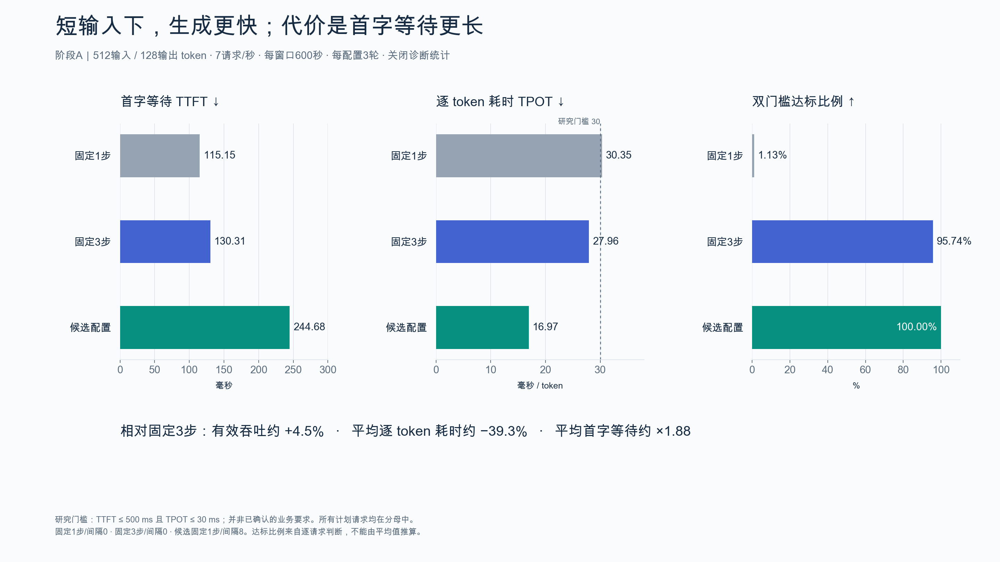
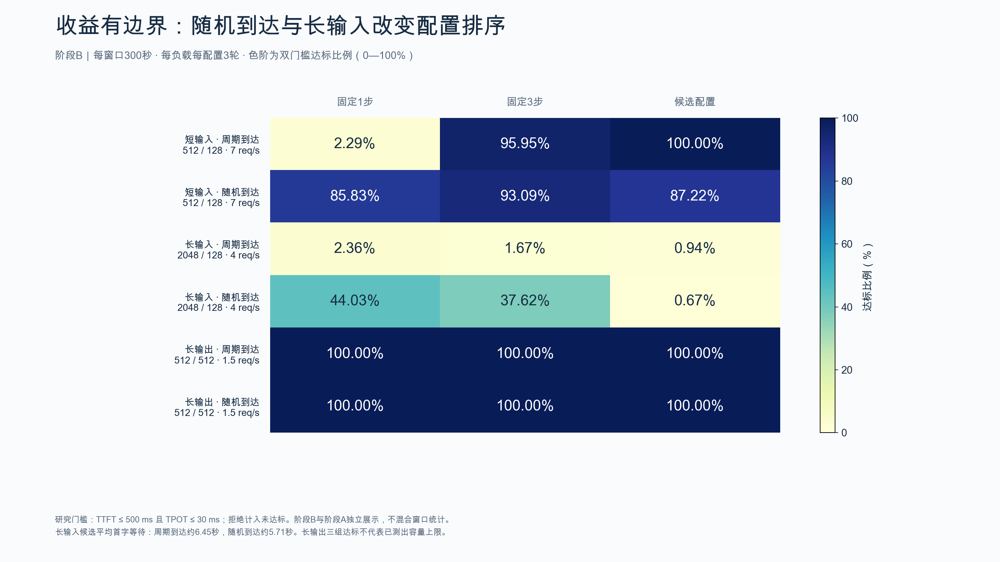

# infra-public

这个仓库用于向导师和组内同学展示推理基础设施研究的阶段进展，也作为组会汇报的材料入口。当前主线是 DeepSeek-V4-Flash / SGLang 在四张 RTX PRO 6000 上的部署、MTP 与调度性能研究。

README 更新日期：**2026-10-31**。研究章节由工作 README 脱敏同步，保留各阶段的测量规模、主要结果、反例和待验证项。最近一条阶段记录：[**预填充分块2048/1024对照（2026-10-31）**](REPORT-CHUNK-2026-10-31.md)。

## 研究主线

围绕 MTP 和输入／生成调度，观察收益如何随输入长度、到达节奏和并发条件变化，同时比较吞吐、首 token 延迟、逐 token 耗时和请求达标率。局部步骤变快之后，是否形成端到端收益，需要通过对应负载的完整请求记录判断。

实验逐步从部署与基础基准，推进到性能边界、计时口径、外生到达率、持续负载及独立复验，再进一步检查等待预算、时间线和预填充分块。各阶段的模型版本、框架版本、设备范围和参数以报告为准。

## 组会阅读入口

| 阶段报告 | 汇报时可以讨论的问题 |
|---|---|
| [预填充分块 2048/1024 对照](REPORT-CHUNK-2026-10-31.md) | 较短的单次 GPU 活动是否转化为端到端收益？ |
| [长输入时间线诊断](REPORT-TIMELINE-2026-10-31.md) | 输入处理和验证步骤怎样交错？ |
| [等待预算原型](REPORT-WAIT-BUDGET-2026-10-31.md) | 首字等待改善是否伴随生成速度退化？ |
| [MTP 步数与调度间隔初筛](REPORT-FACTORIAL-2026-10-31.md) | 步数与调度间隔的组合怎样影响结果？ |
| [夜间独立复验与负载边界](REPORT-OVERNIGHT-2026-10-31.md) | 短输入收益能否跨到达节奏和长输入成立？ |
| [TTFT 口径与到达节奏归因](REPORT-TTFT-ATTRIBUTION.md) | 旧的首字延迟差异包含哪些测量和排队因素？ |
| [持续负载下的调度实验](REPORT-SUSTAINED-SCHEDULING.md) | 短窗口观察在持续输入时是否成立？ |
| [有效吞吐与请求达标率](REPORT-GOODPUT.md) | 满足延迟要求的请求比例如何变化？ |
| [MTP 性能边界](REPORT-MTP-BOUNDARY.md) | 哪些负载受益，候选为何没有通过默认配置门槛？ |
| [部署与基础基准](REPORT.md) | 部署环境、TP 配置和基础测量是否可核对？ |

汇报时可以先讲清本轮问题和对照条件，再展示结果与反例，最后区分已经测得的现象、机制推断和下一步需要验证的方向。需要追溯早期配置或测量口径时，再回看相应阶段报告。

## 指标与结论的阅读方式

| 指标 | 主要关注的问题 |
|---|---|
| TTFT | 请求到第一个 token 的等待是否增加；比较时是否统一到达条件与计时口径。 |
| TPOT | 生成阶段的逐 token 耗时是否下降，以及是否伴随首字等待增加。 |
| 吞吐 | 相同负载与时间口径下完成多少有效生成；不把最大 token 吞吐直接替代延迟达标能力。 |
| 请求达标率 | 同时满足研究延迟门槛的请求比例；相应实验将本地拒绝计入未达标分母。 |

有效吞吐阶段使用预先冻结的研究阈值 TTFT≤500ms、TPOT≤30ms；这组阈值用于研究比较，不代表已经确认的业务 SLO。不同阶段的请求数、测试数及窗口口径分别属于各自实验，不直接累加为统一基准。

## 阶段进展

下文保留工作 README 中各研究阶段的记录。其中的服务状态、测试数和恢复验收描述对应实验当时的记录，不代表此次同步重新运行了实验或检查了服务器。部分原始证据不随公开仓库发布，具体边界见 [PUBLICATION.md](PUBLICATION.md)。

### MTP 性能边界研究（2026-10-30）

研究范围、执行方案和阶段结果：

- [研究设计](docs/superpowers/specs/2026-10-30-mtp-performance-boundary-design.md)
- [执行计划与检查点](docs/superpowers/plans/2026-10-30-mtp-performance-boundary.md)
- [MTP 性能边界与瓶颈报告](REPORT-MTP-BOUNDARY.md)

本轮证据目录：`results/mtp-study-2026-10-30/run-20261030T070100Z/`。
本轮已完成：主基准54组、补测12组、深度筛选9组、独立验证20组、分段回放12组，共107组正式测量、26,776个正式请求，以及24份rank trace。候选因TTFT超出预设退化门槛而不保留；原四卡固定3步MTP服务已恢复，本地与远端各50项测试通过。最终验收见该目录的 `completion.json` 和 `SHA256SUMS`。
`REPORT.md` 保留为先前部署实测记录，不代表新的持续负载结论。

### TTFT计时口径与到达节奏归因（2026-10-30）

[诊断报告](REPORT-TTFT-ATTRIBUTION.md)对旧闭环TTFT差异作进一步归因。27个控制窗口、873个正式请求显示：统一到达条件下，固定1步与3步的首字延迟相近，旧2.65倍均值差异包含闭环到达反馈与排队效应。原始研究结果保留；当前服务继续使用原固定3步MTP，诊断开关已关闭。

本轮证据在 `results/ttft-study-2026-10-30/run-20261030T121601Z/`，状态及边界见 `completion.json`。

### 外生到达率下的有效吞吐（2026-10-30）

[有效吞吐报告](REPORT-GOODPUT.md)在预先冻结的研究阈值TTFT≤500ms、TPOT≤30ms下，比较普通解码与固定1／3步MTP。到达率4／7／9req/s、每点3轮，共27窗口、5,400正式计划请求；本地拒绝计入未达标分母。对照使用相同输入和到达时间表，不把token最大吞吐替代延迟达标能力。

本轮结果、限制与恢复验收在 `results/goodput-study-2026-10-30/run-20261030T134707Z/` 的 `summary.json`、`completion.json`、`SHA256SUMS`。服务保持原四卡固定3步MTP，临时诊断开关已关闭。

### 持续负载与输入／生成调度（2026-10-30）

[持续负载报告](REPORT-SUSTAINED-SCHEDULING.md)将7req/s输入窗口延长至120秒，比较固定1步、固定3步与固定1步+8轮prefill/decode间隔。9窗口、7,560计划请求使用相同输入与时间表；单列中心60秒队列、SSE间隔及prefill日志观察，避免把短窗口或排空等同稳态容量。

本轮证据与完成记录在 `results/sustained-study-2026-10-30/run-20261030T143405Z/`；候选未自动常驻，服务恢复原固定3步、间隔0、关闭诊断统计。

### 夜间独立复验（2026-10-30～31）

[夜间研究报告](REPORT-OVERNIGHT-2026-10-31.md)已核验63/63窗口、104,940个计划请求；交付状态为`completed`，未完成项按实际列入completion.json。关闭诊断统计后的短输入候选收益与长输入反例均保留，未自动改变常驻配置。

运行目录：`results/overnight-study-2026-10-30/run-20261030T154057Z/`。简短工作记录为`MORNING-SUMMARY.md`；完整原始数据回收范围、服务恢复、测试和文件校验见`completion.json`、`service-acceptance.json`、`SHA256SUMS`。

### MTP步数与调度间隔的四配置初筛（2026-10-31）

[四配置初筛报告](REPORT-FACTORIAL-2026-10-31.md)补齐固定3步/间隔8，对照步数1/3与调度间隔0/8四种组合。短输入与长输入各120秒，单轮共8窗口、5280个正式计划请求，5145次成功、135次在途上限拒绝，无非预期服务/网络错误。

本地逐请求复算和远端独立审计一致；新增组合未解决长输入等待，候选未常驻。原四卡固定3步/间隔0服务已恢复并独立验收，本地和远端各81项测试通过。证据目录为`results/factorial-study-2026-10-31/run-20261031T024039Z/`，完整性和恢复记录见该目录`completion.json`、`service-acceptance.json`及`SHA256SUMS`。本轮为单固定顺序的初筛，不作为重复确认或生产容量证明。

### 等待预算原型（2026-10-31）

[等待预算原型报告](REPORT-WAIT-BUDGET-2026-10-31.md)在原常驻、间隔8、仅同步对照及100ms等待预算之间做8个120秒窗口的初筛。5280次正式计划请求全部核验，5184次成功、96次在途上限拒绝，无非预期服务或网络错误。

预算将长输入平均首字从约5.70秒降到379ms且消除本窗口拒绝，但逐token耗时升至39.63ms，双门槛达标率仍只有7.08%，中心60%队列为0%。原型未推广。原服务恢复且安装源码未变，覆盖环境清除，本地和远端各102项测试通过。

证据目录：`results/wait-budget-study-2026-10-31/run-20261031T034015Z/`。正式原始数据全部回收并本地复算，状态和范围见`completion.json`、`retrieval.json`、`service-acceptance.json`与`SHA256SUMS`。

### 长输入时间线诊断（2026-10-31）

[时间线诊断报告](REPORT-TIMELINE-2026-10-31.md)在固定MTP1步下比较间隔0/8及100ms预算，各做无采样和采样窗口，共6窗口2880次正式计划请求。12份rank原始trace全部回收并本地复算。

48步快照中间隔8有5次输入处理/43次验证，预算与间隔0均为12次/36次；验证批大小分别为8、22和16至19，单次2048token输入处理GPU活动约150ms。观察支持进一步研究较小prefill分块，尚未确认唯一瓶颈。采样扰动和三次自动停止后重复stop返回500均保留。

证据目录：`results/timeline-study-2026-10-31/run-20261031T043757Z/`。状态completed，原固定3步/间隔0服务已恢复、覆盖环境清除、源码未变，本地和远端各115项测试及4项审计规则测试通过。原始数据范围和验收见completion.json、retrieval.json、trace-retrieval.json、service-acceptance.json与SHA256SUMS。

### 预填充分块2048/1024对照（2026-10-31）

[分块对照报告](REPORT-CHUNK-2026-10-31.md)固定MTP1步、interval8、100ms预算和协调广播，单独改变分块2048/1024。4窗口1920正式计划请求、8份rank原始trace全部核验并本地复算。两组各4条长输入确定性输出一致。

1024分块的无采样平均首字由352.58ms增至626.98ms，逐token由40.36ms增至57.02ms，并新增39次在途拒绝。单次输入GPU活动变短但次数增加，未形成端到端收益。原型不推广，原3步/interval0/chunk2048服务已恢复，本地和远端各122项测试通过。

证据目录：`results/chunk-study-2026-10-31/run-20261031T052225Z/`。完整范围、原服务恢复和文件校验见completion.json、service-acceptance.json、retrieval.json、trace-retrieval.json及SHA256SUMS。下一步先核对续块与间隔/等待预算的交互，尚未追加实验。

## 下一步

以下是工作 README 最新阶段记录中的待验证方向，按计划信息保留，不视为已经完成的实验结果。

下一步先核对续块与间隔/等待预算的交互，尚未追加实验。

## 组会图表

以下图表对应夜间独立复验阶段，便于汇报短输入收益与负载边界；后续等待预算、时间线和分块实验以各自报告为准。





另外两张图表：[阈值敏感性](results/briefing-2026-10-31/03-threshold-sensitivity.png)、[该阶段进展回顾](results/briefing-2026-10-31/04-progress-and-plan.png)。

## 代码、文档与证据

- `scripts/launch.py`、`scripts/bench_suite.py`、`scripts/stop.py`：部署、基准测量和项目进程范围校验。
- `scripts/` 中各研究阶段的执行器、指标复算与诊断模块，以及对应的 `tests/`。
- `docs/superpowers/specs/` 与 `docs/superpowers/plans/`：研究设计、执行方案和检查点。
- `results/`：选定的脱敏汇总、阶段完成记录和图表；`results/final-summary.json` 为基础测量的公开派生汇总。
- `PUBLICATION.json`：公开文件的校验清单。[公开材料说明](PUBLICATION.md)记录脱敏范围、证据边界和完整复算要求。

公开仓库不包含完整原始请求、trace、模型或远端运行环境。阶段记录中引用的原始 `SHA256SUMS` 对应私有原件，不能用于校验脱敏后的公开文件。

## 本地检查与运行条件

```bash
python3 -m unittest discover -s tests -v
python3 tools/check_publication.py
```

服务器账号、地址、个人路径和硬件唯一标识已替换为占位值。`scripts/launch.py` 保留设备白名单校验逻辑，UUID 使用匿名值；在自己的授权环境运行前，需要核对设备、依赖与模型，并配置相应白名单。文档中的 `$HOME`、`$LOCAL_HOME`、`research-user` 和 `gpu-node` 表示需自行适配的环境信息。
