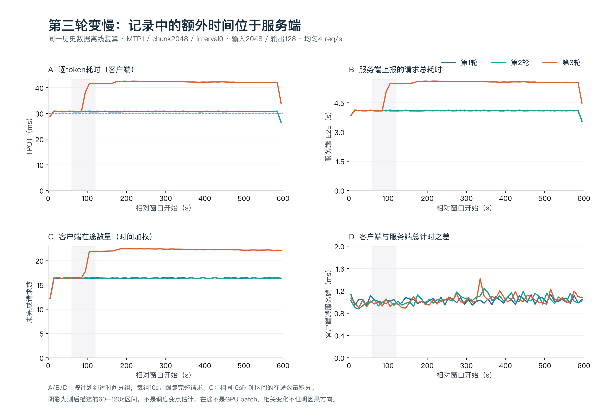
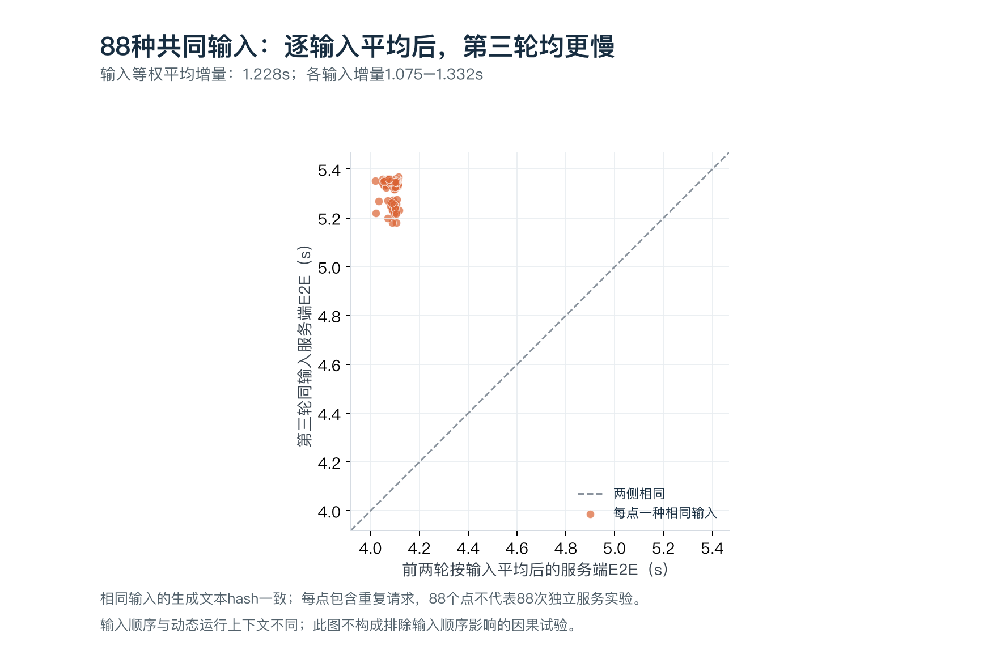

# 第三轮耗时上升：原始记录离线审计

离线证据截止：2026-11-01T12:44:05+08:00。本阶段完成36个既有负载窗口、75,108次计划请求的复核，重点比较其中三个MTP1/chunk2048/interval0、2048输入/128输出、均匀4 req/s窗口的7,200次请求。新增GPU请求0；未访问远端，服务状态仍仅引用05:53的历史验收。

目前将问题缩小到：相同记录的输出和验证工作数量下，第三轮出现更长的服务端请求总耗时，并伴随客户端在途增加。已经有证据削弱客户端额外开销、记录中的验证次数变多或平均值被少量不同输入拉高这几种解释；仍缺服务端调度与GPU阶段时间线，不能宣布根因。

## 已核验的观察

| 项目 | 第1轮 | 第2轮 | 第3轮 |
|---|---:|---:|---:|
|客户端请求总耗时s|4.086978|4.088512|5.315084|
|服务端上报E2E s|4.085949|4.087474|5.314048|
|客户端减服务端ms|1.0291|1.0379|1.0360|
|首字ms|195.8877|195.7721|204.0624|
|TPOT ms|30.6385|30.6515|40.2443|
| 成功/计划 | 2400/2400 | 2400/2400 | 2400/2400 |
| 每条请求验证次数 | 全部64 | 全部64 | 全部64 |
| 每条正确/提出草稿数 | 全部64/64 | 全部64/64 | 全部64/64 |
| 输出token/缓存token/回退次数 | 128/0/0 | 128/0/0 | 128/0/0 |

第三轮相对前两轮均值：客户端请求总耗时增加1227.340ms，服务端上报耗时增加1227.337ms；两套计时差的变化仅0.0025ms。额外耗时主要体现在服务端报告值里。该差值不是纯网络耗时，服务端E2E也不是GPU kernel时间。

验证计数、草稿计数和直方图在全部7,200请求中一致，未观察到接受工作数量变化。相同次数仍可能有更慢的单轮验证，或更多穿插/等待；这些元数据不能分解GPU、CPU、排队和通信耗时。没有把accept_length当作速度或因果证据。

三个服务启动快照的全部非startup_time字段相同；仅startup_time及内部同名启动时长不同。启动参数一致仍不等于相同温度、频率或动态批处理状态。

## 按时序重建客户端可见的在途数量

将每次入服务请求表示为[start_time,start_time+latency)半开区间；本地cap32拒绝不进入区间。客户端在途的时钟区间积分先用事件扫描计算，再用逐请求裁剪区间求和独立复核。把首段文本到结束的区间另计为“首字后仍未完成”的代理。它们都不是实际GPU batch、服务队列或正在同一verify里运行的请求数。

| 120–480s中心时段 | 第1轮 | 第2轮 | 第3轮 |
|---|---:|---:|---:|
| 时间加权客户端在途 |16.4044|16.4006|22.2949|
| 发送时在途（含本请求）均值 |17.0000|17.0000|22.8778|
| 首字后未完成的时间加权代理 |15.6212|15.6163|21.4693|

第三轮90–100s计划到达组的完整请求平均TPOT约38.33ms，100–110s组约41.57ms；80–90s组约30.74ms。仅定位到发生变化的到达组，不能据此把90s称为精确GPU/调度变点。各到达组的生命周期可能跨越分界。



图中A/B/D按计划到达分组并跟踪完整请求，C则对相同10s时钟区间积分。第三轮在途增长与耗时上升相伴：请求变慢本身就会留下更多在途，也可能形成批处理/排队反馈，当前不能判定哪个是起因。

## 相同输入身份的复核

三个窗口共有88种输入hash。先分别在每轮内对同一种输入平均，再把前两轮平均与第三轮作差，88种输入的服务端总耗时差均为正。按输入身份等权的平均增加1227.746ms，逐输入范围1074.685—1332.346ms。相同输入的所有成功输出文本hash一致。



这削弱了“第三轮均值只是混入少量不同/更难输入”的解释，但没有排除输入顺序和动态上下文的影响。轮间输入顺序不同，同一输入会在不同时间、不同在途状态出现；逐输入比较不是随机化因果对照。88种输入也不是88次独立服务重复。

## 哪些判断可下，哪些仍未解决

| 判断 | 证据强度与边界 |
|---|---|
| 额外约1.23秒体现在服务端上报耗时 | 直接记录支持；不等于纯GPU计算增加1.23秒。 |
| 已记录的验证次数、草稿计数没有退化 | 7,200条逐请求核验；不能排除每轮验证变慢或验证间穿插/等待。 |
| 同一输入身份对齐后仍慢 | 88种全部同向；不能排除输入顺序或动态状态作用。 |
| 在途增加与变慢同时出现 | 可从客户端时间戳重建；不是GPU batch证据，因果方向未知。 |
| 温度/降频/通信/调度中的某一项是根因 | 暂无足够测量，不选定原因。 |

证据目录：[本次离线审计](results/drift-audit-2026-11-01/run-20261101T044359Z/README.md)。

## 完成范围、复算与下一步

本阶段是历史记录的离线审计完成，在线机制仍待诊断。没有重启服务、重新运行负载、更新自动任务或修改夜间协议和原始记录。已核对291份证据（287份远端捕获文件及4份本地审计/完成文件），分析前后全部hash一致。新增七项针对边界与元数据计量的测试通过，拒绝、缺失计数、重复index和时钟积分均有检查。

- summary.json：36窗口复核、计数和主比较。
- time-bins.csv / .json：2,160个10秒分组以及独立时钟区间在途积分。
- matched-inputs.json：88种输入的对齐结果，不输出语料文本。
- configuration-comparison.json：三轮启动字段的非耗时字段一致性。
- sources.json：输入证据SHA256，分析前后复核。
- figures/：可导出PNG和PDF。
- NEXT-DIAGNOSTIC.md：围绕转变区间的最小在线诊断设计，状态为未执行。

复算命令（输出目录须不存在，避免覆盖历史结果）：

```bash
python3 scripts/drift_audit.py --source-run results/night-isolation-2026-10-31/run-20261031T152137Z-attempt02-fresh --output-dir results/drift-audit-2026-11-01/run-NEW
python3 tools/render_drift_audit.py --audit-dir results/drift-audit-2026-11-01/run-20261101T044359Z
```

绘图需要Matplotlib与Pillow；本次使用既有本地绘图环境，不新增下载。在线下一步应直接观察实际调度batch、输入与验证交错及GPU/CPU阶段，先确认变化可复现，再捕获有界采样。没有把下一轮计划计入已完成实验。
