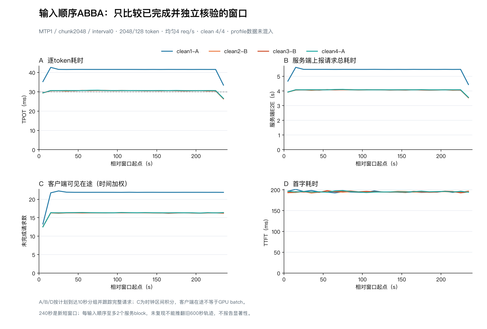

# 第三轮变化：ABBA短时在线诊断报告

定稿：2026-11-01T14:46:43+08:00。真实状态completed；4/4个clean窗口、3840次正式计划请求，其中3840成功、0本地即时拒绝。独立审计和原服务恢复验收已完成。

本轮目标是验证历史输入顺序下的状态变化是否可复现，既有第1/3轮输入顺序分别定义为A/B，按ABBA四个独立服务block运行。不是重跑完整夜间队列，也不与旧数据合并。

## 协议与真实执行

- 唯一配置：MTP1、chunk2048、interval0，TP4、同一模型revision，物理GPU0–3、127.0.0.1:30000。
- 相同2048输入/128输出，均匀4req/s；每窗口240秒、960正式计划请求、8次预热。A/B分别是旧第1/3轮冻结序列前960条，输入与到达定义逐条核验。
- 全程每请求新连接、不重试POST，cap32即时拒绝、45秒请求超时、100ms发送偏差门槛不变；每个block独立重启固定MTP1服务。额外8次冒烟和各窗口预热单列。
- 本轮新增1Hz四卡温度、频率、功耗、利用率监测；这是与旧600秒运行不同的测量条件。采样只作相关描述，不能当GPU kernel trace或降频原因证明。
- 执行器自14:18:42起最多45分钟，实验cutoff预留10分钟恢复；没有新建夜间心跳或重复执行器。

## 四个clean窗口

| 窗口 | 顺序 | 计划/成功 | 拒绝 | 首字ms | TPOTms | 服务端E2E s | 中心在途（时间加权） | 转变门槛 |
|---|---|---:|---:|---:|---:|---:|---:|---|
|clean1-A|A|960/960|0|195.229|40.9928|5.4003|21.8871|[]|
|clean2-B|B|960/960|0|194.863|30.3203|4.0446|16.3114|[]|
|clean3-B|B|960/960|0|195.224|30.3529|4.0490|16.3256|[]|
|clean4-A|A|960/960|0|195.437|30.4140|4.0570|16.3508|[]|

A顺序两次TPOT为40.9928/30.4140ms，B顺序为30.3203/30.3529ms。每种顺序仅两个独立服务block，不能仅凭本轮将输入顺序称为因果解释或报告显著性。旧A曾较快、旧B曾在窗口中途变慢；须保留新的各窗口值与历史反例，不将某顺序固定贴为快/慢标签。

同一A顺序在本轮独立重启后，一次40.9928ms、一次30.4140ms，直接提供了“顺序相同而所测状态不同”的反例。因此不能把A/B身份单独作为确定快慢的充分解释；仍未区分初始化微时序、调度交错或其它系统状态。

## 门槛与采样

测前冻结的门槛：相邻连续三个10秒计划到达组TPOT均<33ms，随后三个组均>35ms；必须四个clean全部有效，才按ABBA顺序首个满足case选择相同输入顺序，额外至多执行一个240秒profile窗口，在90秒请求48forward-step CPU/GPU采样。此门槛用于取证，不替换30ms SLO。

本轮没有窗口满足测前固定的先低后高门槛，因此未启动profile。观察到慢状态并不等于复现旧的时间内转变，未触发也不能称完全没有异常。

独立门槛判定：{'status': 'not_triggered', 'reason': 'No clean case met the predeclared3-before/3-after descriptive gate'}。已执行profile窗口0，profile计划请求0。

## 请求元数据和监测

所有已审计生成请求的实际token数、零retraction、新连接和发送偏差通过；clean窗口每请求验证次数和正确/提出草稿数均为64/64/64。相同成功输入身份的跨窗口文本hash对照通过；拒绝请求不作为已核验文本。

| 窗口 | GPU | 样本 | 温度℃ | SM频率MHz | 功耗W |
|---|---:|---:|---:|---:|---:|
|clean1-A|0|240|36–53|2287–2407|163.0–342.1|
|clean1-A|1|240|36–54|2287–2407|161.6–330.6|
|clean1-A|2|240|36–53|2287–2407|163.9–333.5|
|clean1-A|3|240|35–52|2272–2407|159.7–336.3|
|clean2-B|0|239|44–54|2310–2407|222.3–328.4|
|clean2-B|1|239|44–54|2310–2400|217.7–326.8|
|clean2-B|2|239|44–54|2332–2407|225.9–326.9|
|clean2-B|3|239|42–53|2280–2400|218.1–322.4|
|clean3-B|0|239|44–54|2302–2407|242.5–329.0|
|clean3-B|1|239|45–54|2340–2407|234.7–326.3|
|clean3-B|2|239|45–54|2332–2407|226.0–327.3|
|clean3-B|3|239|44–53|2287–2400|234.7–322.5|
|clean4-A|0|239|42–54|2302–2407|197.7–327.9|
|clean4-A|1|239|45–54|2295–2400|193.5–325.4|
|clean4-A|2|239|43–54|2325–2407|198.6–325.5|
|clean4-A|3|239|44–53|2280–2400|194.1–322.1|

远端时区偏移0已实时核验；按客户端epoch起点匹配1Hz墙钟样本。样本含窗口起始瞬态，区间极值不足以决定温度/频率因果；没有采到驱动限频原因字段，不从温度范围推导“未限频”或“已限频”。

服务端E2E是请求总计时，不是GPU compute；客户端在途是区间重建代理，不是实际batch。输入顺序、初始化微时序、排队、系统状态和监测开销未被单独随机隔离。新增240秒窗口不替代完整600秒旧异常轨迹。

## 恢复、回收和后续

原TP4固定3步/interval0/chunk2048命令已精确恢复，PID1056981；实际argv、四卡UUID归属、主/子进程环境、health/models、中文/算术、安装源码和冻结代码hash全部验收。服务器预检、执行器最终与独立最终均完成163项测试；本地163项中161通过、2项只适用于远端aiohttp环境的连接集成测试明确跳过。执行器已退出、锁可用，无遗留实验客户端。

原始与支持文件72份、7610801字节已回收，并逐项匹配远端SHA256与大小。恢复后持续写入的服务日志按最终检查时刻捕获精确字节前缀；后续服务日志不计入本轮范围。无未回收正式请求。

本阶段止于预先限定的四个clean及条件profile；不追加窗口、不放宽门槛、不推广配置。下一项应利用已观察到的状态，设计能分别覆盖快/慢状态的实际scheduler batch与输入/验证交错取证，而非继续盲换输入顺序。本轮并未证实根因，后续方案须明确采样覆盖和观察开销。

文件入口：protocol.json、audit-local.json、analysis/summary.json、analysis/ten-second-cohorts.csv、analysis/text-hash-comparison.json、retrieval-final-verified.json、completion.json及SHA256SUMS。
