# DeepSeek-V4-Flash 推理实验与优化长期工作报告

更新日期：**2026-11-01**。维护方式：累计更新同一文档；[11月1日日报](daily/2026-11-01.md)已按北京时间2026-10-31 17:00至2026-11-01 15:01:27收口，之后的新增工作归入[11月2日日报](daily/2026-11-02.md)。

最新在线阶段为 **2026-11-01 单配置ABBA短时诊断**：4个240秒窗口、3840正式请求全部完成；14:41:22恢复原服务，14:42:45独立验收通过，最新闭环检查为14:44:45（北京时间）。夜间完整40case/75,236请求的06:02:47定稿与离线审计另保留，本轮数据不与它们合并。

本报告采用用户提供的《DeepSeek V4 Flash 0731 推理实验记录（2026-10-30）》的细节层次：环境与启动参数、测量协议、完整测点、性能曲线、模块活动、失败与恢复、复现步骤及限制。参考材料的测量属于另一模型 revision / vLLM / DSpark 配置，未并入本项目结果。没有实测的长上下文、外部 API、缓存命中、费用和硬件理论上限单独列为未覆盖。

**阅读路径**：1 实验概览；2 环境与服务配置；3 协议与指标；4 部署筛选；5 MTP完整主基准与候选；6 GPU阶段活动；7 TTFT归因；8 有效吞吐；9 持续负载与适用边界；10 等待预算与分块；11 最新独立执行；12 失败、质量与恢复；13 复现与数据；14 未解决问题；15 共同维护；附录A/B/C完整测点。

## 1. 实验概览

### 1.1 目标与已确认范围

研究对象是四卡 TP=4 下的 DeepSeek-V4-Flash / SGLang 推理。第一步建立可核验的服务与指标；第二步确定 MTP 在不同并发和长度下的性能边界；第三步用相同外部到达表研究首字等待、生成耗时及调度取舍；第四步隔离预填充分块的无竞争成本，并复验其在较长输入窗口中的表现。

当前可用于汇报的主要结论如下。所有“更快”“改善”都限定于相应冻结负载，不能直接形成框架或硬件排名。

**表 1　主要结论、依据及限制**

| 问题 | 结果 | 证据范围 |
|---|---|---|
| 单流速度 | 512/128 主基准：普通101.85、固定3步MTP187.70 tok/s；另两种长度的MTP为194.05/212.25 tok/s。 | C=1、三轮无profiler基准；整体输出包含输入处理与首字等待。 |
| MTP并发边界 | 三种长度C=1约1.84–1.96倍；C=32均低于1。 | 主提示集54窗口。独立提示集可改变排序，不外推所有请求。 |
| TTFT机制 | 固定1/3步在统一同时到达时TTFT比为1.001，固定4 req/s时为0.970。 | 支持闭环补发/排队影响；未证明单请求计算固有增加2.65倍。 |
| 调度收益 | 短输入周期到达有收益，随机到达和长输入有反例。 | 已有夜间63窗口复验；500ms/30ms仍为研究门槛。 |
| 分块成本 | 第二次独立执行中，1024比2048的单请求首响应多39.408ms（输出1）/38.829ms（输出128）。 | 每配置2个ABBA服务block，客户端总计时，不是纯GPU成本。 |
| 长输入高负载 | 1024分块三轮均有更高TPOT和更多本地拒绝；MTP1/2048第三轮出现变化。 | 600秒、4种负载、3配置×3轮；保留变化与未解释机制。 |
| 第三轮变化离线核验 | 7200条目标请求的验证次数均64；额外约1.227秒体现在服务端报告；中心时段客户端在途约16.40→22.29。 | 同一历史数据，88种共同输入同向变慢；不是GPU batch或已证实因果。 |
| 短时输入顺序对照 | 同一A顺序两次TPOT40.9928/30.4140ms；B两次30.3203/30.3529ms。 | 4×240秒、3840正式请求；未触发预设转变采样门槛，profile0，不判定根因。 |
| 完成与恢复 | 夜间40case已收口；本轮4case完成，原服务14:42独立验收通过。 | 各阶段独立计数；本轮访问远端，具体检查时刻见11.6。 |

### 1.2 实验目录与计数边界

下表按研究依赖整理。窗口、case、计划请求、成功请求、独立服务block和rank trace不是同一个统计单位。单流复核、本文重绘图及附录A都取自同一主基准，**不能再计为新实验**；各阶段之间协议不同，也不合并为一个“总性能”或统计样本量。

**表 2　实验目录与正式范围**

| 编号 / 阶段 | 正式窗口或case | 请求范围 | 计数备注 | 阶段资料 |
|---|---|---|---|---|
| E0 部署筛选 | 29份JSONL | 788完成请求 | 短窗口与TP2筛选 | [报告](REPORT.md) |
| E1 MTP性能边界 | 107 | 26,776 | 完成正式请求 | [报告](REPORT-MTP-BOUNDARY.md) |
| E2 TTFT归因 | 27 | 873 | 按阶段定义的正式请求 | [报告](REPORT-TTFT-ATTRIBUTION.md) |
| E3 有效吞吐 | 27 | 5,400 | 按阶段定义的正式请求 | [报告](REPORT-GOODPUT.md) |
| E4 120秒持续输入 | 9 | 7,560 | 按阶段定义的正式请求 | [报告](REPORT-SUSTAINED-SCHEDULING.md) |
| E5 既有夜间复验 | 63 | 104,940 | 计划请求，包含本地拒绝 | [报告](REPORT-OVERNIGHT-2026-10-31.md) |
| E6 四配置初筛 | 8 | 5,280 | 计划请求，包含本地拒绝 | [报告](REPORT-FACTORIAL-2026-10-31.md) |
| E7 等待预算 | 8 | 5,280 | 计划请求，包含本地拒绝 | [报告](REPORT-WAIT-BUDGET-2026-10-31.md) |
| E8 时间线 | 6 | 2,880 | 计划请求，包含本地拒绝 | [报告](REPORT-TIMELINE-2026-10-31.md) |
| E9 分块 | 4 | 1,920 | 计划请求，包含本地拒绝 | [报告](REPORT-CHUNK-2026-10-31.md) |
| E10 续块保护 | 4 | 1,920 | 计划请求，包含本地拒绝 | [报告](REPORT-CONTINUATION-2026-10-31.md) |
| E11 首次夜间分块执行（失败） | 15个已审计正式case | 22,818已审计；失败窗口另列 | 不混入第二次正式均值 | [失败与恢复](REPORT-NIGHT-ISOLATION-2026-11-01.md) |
| E12 第二次夜间分块执行 | 40 = 4微测block + 36负载窗 | 75,236计划 / 73,291成功 / 1,945拒绝 | 额外8冒烟及328预热单列 | [最终报告](REPORT-NIGHT-ISOLATION-2026-11-01.md) |
| E13 第三轮变化离线审计 | 复核既有36窗口，重点3窗口 | 75,108既有计划请求；重点7,200 | 新增GPU请求0；不增加独立实验数 | [离线审计](REPORT-DRIFT-AUDIT-2026-11-01.md) |
| E14 单配置输入顺序ABBA短时诊断 | 4个240秒clean窗口，profile0 | 3,840计划/成功；拒绝0 | 额外8冒烟与40预热；未触发条件采样 | [短时诊断](REPORT-DRIFT-DIAGNOSTIC-2026-11-01.md) |

## 2. 模型、硬件、软件与服务配置

### 2.1 固定环境

环境信息来自部署记录、主基准冻结配置及最新恢复验收。硬件型号、软件版本和模型文件范围与同学的0731报告不同；没有将对方的张量组成、DSpark参数和长上下文能力写作本项目事实。

**表 3　本项目环境**

| 项目 | 固定记录 | 用途或边界 |
|---|---|---|
| 模型 | deepseek-ai/DeepSeek-V4-Flash | 推理部署与性能研究，不含训练/微调。 |
| 模型revision | 60d8d70770c6776ff598c94bb586a859a38244f1 | 复现实验需匹配权重版本。 |
| 权重文件 | 46个safetensors分片，官方文件总大小约159.6GB | 没有重新统计本模型各子模块字节，不能借用参考PDF的155.418GiB分解。 |
| GPU | 4×RTX PRO 6000 Blackwell Server Edition；各97887MiB；SM120 | 仅获准物理卡0–3。卡UUID在私有证据中核验，不在公开文档列出。 |
| 驱动与Python | 580.178.04；Python3.12.16 | 来自部署预检。 |
| 推理栈 | SGLang0.5.23；PyTorch2.14.1+cu130；FlashInfer0.7.2；Transformers5.19.0 | 固定版本内解释结果。 |
| 通信预检 | 四卡P2P矩阵均为True；Triton编译与执行通过 | 不等于已测PCIe饱和，也不构成硬件roofline。 |
| 早期显存记录 | 验收时每卡约90661MiB/97887MiB | 历史加载快照；显存占用不证明活跃计算或带宽饱和。 |

### 2.2 关键服务参数

以下为主基准与恢复后的原默认配置。后续实验只在明确记录的变量上改变；诊断日志、metrics、步数、interval和chunk均在各阶段说明。

**表 4　默认服务参数与含义**

| 参数 | 值 | 含义 / 控制点 |
|---|---|---|
| --tp | 4 | 四张卡构成同一TP副本。 |
| --moe-runner-backend | flashinfer_mxfp4 | 固定MoE执行后端。 |
| --mem-fraction-static | 0.92 | 静态显存预算比例；不等于已测实际权重/KV占比。 |
| --context-length | 8192 | 本研究服务上限；尚未做8K/1024、32K至1M对齐扫描。 |
| --chunked-prefill-size | 2048（候选1024） | 单次输入处理预算；改变会影响次数与上下文续算。 |
| --max-running-requests | 32 | 服务运行请求限制；外部负载客户端另有共同32在途拒绝保护。 |
| --cuda-graph-max-bs-decode | 32 | 保留CUDA Graph，避免与禁图运行混比。 |
| --disable-radix-cache | 启用 | 关闭前缀缓存，不将命中收益计入主基准。 |
| --speculative-algorithm | EAGLE | 本项目MTP执行路径。 |
| --speculative-num-steps / topk / draft-tokens | 3 / 1 / 4 | MTP1候选对应1/1/2；没有放宽接受阈值或权重精度。 |
| --prefill-decode-interval | 原默认0；特定候选8 | 调度轮数，不等于8token或精确GPU时间配额。 |
| metrics / request-time-stats | 部分诊断阶段开启，正式夜间复验关闭 | 采样/日志开销与测试条件分别保留。 |
| 服务接口 | 127.0.0.1:30000；deepseek-v4-flash | 仅localhost；无外部API支出。 |

### 2.3 实际启动参数的可复现写法

下列命令是恢复验收argv的等价参数表达，路径用项目相对位置表示。执行前须确认现有服务、获准GPU与显存状态；本文整理过程中未执行这些启动命令。实际操作优先使用项目启动器，它会核验物理GPU及CUDA可见顺序。

```bash
.venv/bin/python scripts/launch.py --gpus 0,1,2,3 --speculative mtp --speculative-steps 3
```

展开后的核心服务参数：

```bash
.venv/bin/python -m sglang.launch_server \
  --model-path models/DeepSeek-V4-Flash \
  --served-model-name deepseek-v4-flash --trust-remote-code \
  --tp 4 --moe-runner-backend flashinfer_mxfp4 \
  --mem-fraction-static 0.92 --context-length 8192 \
  --chunked-prefill-size 2048 --max-running-requests 32 \
  --cuda-graph-max-bs-decode 32 --disable-radix-cache \
  --speculative-algorithm EAGLE --speculative-num-steps 3 \
  --speculative-eagle-topk 1 --speculative-num-draft-tokens 4 \
  --host 127.0.0.1 --port 30000
```

普通解码在启动器中用`--speculative none`；MTP1用`--speculative mtp --speculative-steps 1`。interval8和实验性100ms预算属于相应协议，不是默认参数。最新独立执行恢复记录确认TP4/DP1/PP1、MTP3、interval0、chunk2048、无metrics与时间日志，未保留候选。

## 3. 评测协议、指标与统计单位

### 3.1 已用工作负载

统一控制模型和输出长度并不足以构成公平比较，还需控制提示内容、缓存、到达时刻、日志、连接方式和正式计时范围。下表保留这些主要差异。

**表 5　各主阶段协议**

| 阶段 | 输入 / 输出 | 并发或到达 | 窗口与轮次 | 提示 / 计时控制 |
|---|---|---|---|---|
| E0部署 | 512/128，另2048/256 | C1/8/32；TP2/TP4 | C1仅4计时请求；四卡各三轮 | 独立预热；旧短窗口保留。 |
| E1主基准 | 512/128、2048/256、512/512 | C1/8/32，闭环 | 每轮≥30秒；3轮×2模式 | pilot按较快模式定相同请求数；seed42；精确tokenID。 |
| E1独立验证 | 512/128 | C32 | 每配置5轮×512请求 | 128条新受控提示；seed31415；输入清单hash相同。 |
| E2 TTFT | 512/128 | 单请求 / 同时32 / 固定4req/s | 三轮；873正式请求 | 独立SSE客户端；统一诊断开关与seed20261030。 |
| E3有效吞吐 | 512/128 | 周期4/7/9req/s | 30秒×3轮 | 每窗8预热单列；共同32在途立即拒绝。 |
| E4持续输入 | 512/128 | 周期7req/s | 120秒×3轮 | 840请求循环冻结输入；开启时间日志。 |
| E5夜间复验 | 512/128、2048/128、512/512 | 周期/指数7/4/1.5req/s | 阶段A600秒；B300秒；各3轮 | 关闭诊断；同负载同表；循环GC移出计时。 |
| E6–E10原型与诊断 | 短512/128、长2048/128 | 周期7/4req/s | 120秒；单轮，采样窗另列 | 只改变冻结变量，不能称独立重复确认。 |
| E12 A微测 | 2048/1、2048/128 | 最多1在途 | ABBA四服务block；每block32请求 | 16相同输入；每配置2block；新连接不重试。 |
| E12 B负载 | 512/128、2048/128 | 周期4/2/4及指数标称4req/s | 600秒×3轮×3配置×4负载 | 配置按拉丁轮转；轮间重排输入和随机seed。 |

### 3.2 指标定义与分母

对请求i，实际输出token为`o_i`，请求总耗时为`L_i`，首token等待为`F_i`；benchmark完整计时窗口为T。

- **总输出吞吐 T_out（tok/s）**：`sum(成功且长度校验通过请求的实际输出token) / T`。四卡服务合计；T采用保存的完整测量时长，包含输入处理、到达间隔与末尾排空，排除预热、smoke、服务重启/加载；按GPU归一化时再除以4。拒绝贡献0token，输入token不混入分子。
- 请求TPOT：`(L_i - F_i) / (o_i - 1)`，只对输出大于1的请求定义。先按请求求均值，再按独立轮次等权汇总时，需明确两层统计。
- 达标请求：成功、输出长度正确且TTFT≤500ms、TPOT≤30ms；达标比例分母为全部计划请求，拒绝不剔除。
- **请求有效吞吐（req/s）**：`达标请求数 / T`。**达标输出吞吐 G_out（tok/s）**：`sum(同时满足研究门槛的成功请求实际输出token) / T`。它们都包含末尾排空，不能用计划输入窗口秒数替换T。本次负载成功输出均为128token，所以G_out等于请求有效吞吐×128；以后若输出可变，须逐请求求实际token，不能直接乘配置上限。
- `1000 / 平均TPOT(ms)`是生成速率换算，通常不等于`mean(1000 / 每请求TPOT)`；也不等于整体吞吐/并发。
- TTFT均值、分位数只覆盖成功请求；请求被拒绝时没有可解释的生成延迟，需另列拒绝率。

早期TTFT以首个非空文本计时，新夜间执行同时记录首个正输出token及首文本。本轮两者相同只是观测结果，不应把SSE事件、token计数和文本事件在所有情况下视为同一事件。

**表 6　常见统计量不能互换**

| 统计量 | 本文做法 | 避免的误读 |
|---|---|---|
| 配对加速比 | 每轮MTP/普通比值，再取三轮均值。 | 两个模式均值的比一般不严格等于配对比均值。 |
| 误差线/阴影 | 三轮最小值–最大值，明确为观测范围。 | 不是置信区间，不表示跨业务泛化误差。 |
| P99 E2E | 独立验证用每配置全部2560请求重新合并计算。 | 不把各轮P99均值冒充合并分位数。 |
| 独立重复 | 主基准为轮次；新微测为每配置2服务block。 | 16个输入、数千请求、4个rank都不等于同等独立重复数。 |
| 中心cohort | 按计划到达时刻选中间60%，跟踪完整生命周期。 | 不是按完成时刻分桶，也不是无限时间稳态。 |
| GPU阶段活动 | rank局部GPU区间并集 / 对应CPU注释次数。 | 不能多卡相加除请求延迟，也不能与阶段内通信再相加。 |
| 连接方式 | 第二次夜间每个实际入服务请求恰建一次新连接、零复用、不重试POST。 | 第一次失败与第二次不能合并为同一客户端条件。 |

### 吞吐指标的补充解释

固定并发主基准测得的是该并发上限下的实际整体输出；固定到达率实验的T_out还受所施加流量限制。例如4req/s、每次输出128的计划输出率为512tok/s，实测约511tok/s并不表示模型最大能力只有511。若全部请求最终完成，TPOT变慢主要增加在途和单请求等待，T_out可能近似不变；若触发拒绝，总输出通常下降。

`1000 / 平均TPOT(ms)`是生成速率换算，不是T_out，也不能无条件乘并发还原系统吞吐。G_out补充“输出是否按时交付”，不能代替T_out；三项需与TTFT、拒绝和负载一起解读。三轮T_out/G_out均先逐窗计算再等权平均，未把各窗分子分母拼成新的单一测量。

本次用户要求在已收口日报和累计报告中补充tok/s：依据原始请求与保存时长复算，不改变11月1日15:01:27的日报截止，也不把之后的profile窗口作为clean吞吐结果。[新派生数据](results/throughput-review-2026-11-01/throughput-summary.json)单独保存，无新增GPU实验。

### 3.3 正式请求核验与失败规则

每阶段保存输入/时间表hash、实际token长度、成功数、错误、发送偏差与退出码。共同32在途保护触发时立即本地拒绝，不静默排队或延后补发。预热、冒烟、profiler、失败尝试和正式窗口分别计数。计划发送偏差门槛为100ms；超过门槛的窗口保留并排除，不通过放宽条件消除失败。

本次文档整理重新核对54个主基准原始窗口的吞吐与TPOT公式；核对最新40个正式case原始请求文件与独立审计hash、最终报告hash及完成记录。逐来源摘要见[报告数据](results/work-report-2026-11-01/report-data.json)；不将“hash核验通过”表述成重新执行了实验。

## 4. 早期部署与TP2/TP4筛选

**表 7　早期四卡短窗口三轮均值（512/128）**

| 并发 | TP4 普通解码 输出 tok/s | TP4 MTP 输出 tok/s | MTP/普通 | 普通 TTFT ms | MTP TTFT ms | 普通 TPOT ms | MTP TPOT ms |
|---:|---:|---:|---:|---:|---:|---:|---:|
| 1 | 101.22 | 188.39 | 1.861x | 87.69 | 93.95 | 9.252 | 4.572 |
| 8 | 588.83 | 758.18 | 1.288x | 316.83 | 323.15 | 11.159 | 7.983 |
| 32 | 1288.76 | 1321.95 | 1.026x | 815.98 | 679.02 | 18.551 | 18.654 |

**表 8　TP2单副本筛选，每配置一轮**

| 配置 | 并发 1 输出 tok/s | 并发 8 输出 tok/s | 并发 32 输出 tok/s |
|---|---:|---:|---:|
| TP2 普通解码 / NCCL | 90.33 | 516.62 | 1171.13 |
| TP2 普通解码 / custom all-reduce | 93.85 | 532.20 | 1205.45 |
| TP2 MTP / custom all-reduce | 165.20 | 582.05 | 1179.99 |

早期四卡C1计时仅4请求；后续主基准按独立pilot延长至至少30秒，并扩展请求序列。两个阶段的提示顺序、规模与计时不同，因此早期C32的1.026倍和后续同长度主基准的0.940倍分别保留。不能把差异简单归因于某次优化或测量时长。

TP2 MTP单副本C1约165.20 tok/s，未超过早期TP4 MTP约188.39 tok/s。没有测试两个TP2副本同时服务，不把单副本乘二作为结论。中文/算术探针、模型列表和健康检查只证明基本可用性，不等于完整质量评测。来源：[部署记录](REPORT.md)。

## 5. MTP主基准、补测与候选验证

### 5.1 完整主矩阵与吞吐曲线

主矩阵为3种输入/输出×3个并发×2模式×3轮=54正式窗口，7,032完成请求。每种模式同轮使用相同请求数、seed及精确输入清单；C1的512/128每模式156请求，另两种长度每模式96请求。完整的18组模式均值与延迟见附录A。

**表 9　九组主基准配对比较（每点三轮）**

| 输入／输出 token | 并发 | 普通解码 tok/s | 固定3步MTP tok/s | 配对加速比均值 | 三轮范围 |
|---|---:|---:|---:|---:|---:|
| 512／128 | 1 | 101.85 | 187.70 | 1.843× | 1.840～1.845× |
| 512／128 | 8 | 605.00 | 675.55 | 1.117× | 1.113～1.119× |
| 512／128 | 32 | 1325.57 | 1246.28 | 0.940× | 0.940～0.940× |
| 2048／256 | 1 | 102.82 | 194.05 | 1.887× | 1.882～1.891× |
| 2048／256 | 8 | 518.61 | 617.15 | 1.190× | 1.189～1.193× |
| 2048／256 | 32 | 944.45 | 937.87 | 0.993× | 0.990～0.995× |
| 512／512 | 1 | 108.35 | 212.25 | 1.959× | 1.953～1.964× |
| 512／512 | 8 | 714.20 | 898.50 | 1.258× | 1.257～1.260× |
| 512／512 | 32 | 1905.61 | 1876.08 | 0.985× | 0.983～0.986× |

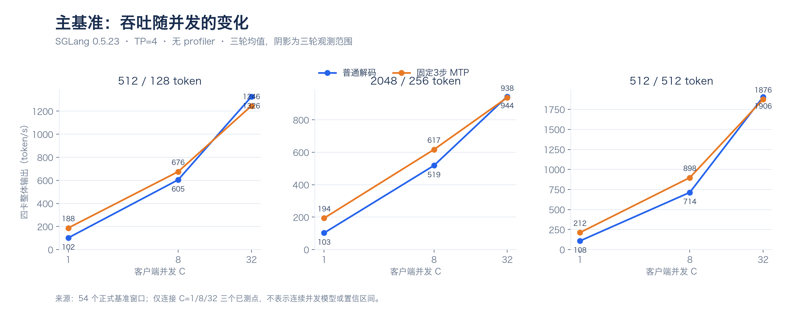

**图 1　整体输出吞吐随并发变化。** 三个面板各自固定输入/输出长度。曲线只连接C1/8/32已测点，阴影为三轮观测范围。低并发收益随批量上升而缩小，不等于随并发的连续理论模型。

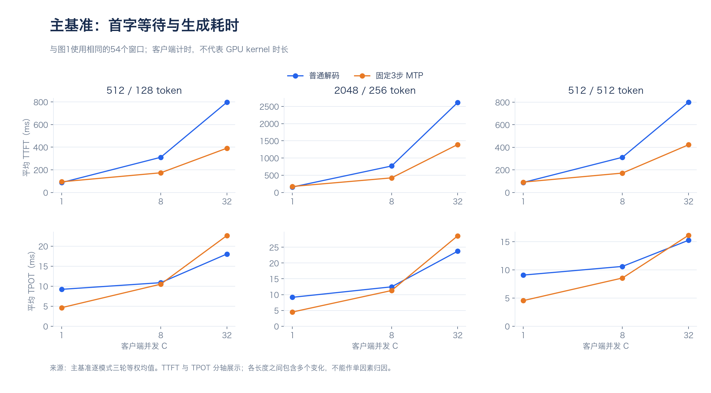

**图 2　相同主基准的TTFT与TPOT。** 上排平均首字、下排平均逐token。虽然固定3步C32的TTFT在部分条件下更低，TPOT可更高，因此不能仅凭TTFT判定生成体验。

### 5.2 单流速度的两种口径

**表 10　C1整体速度与TPOT倒数**

| 输入/输出 | 普通整体tok/s | MTP整体tok/s | MTP TTFT ms | MTP TPOT ms | 1000/均值TPOT tok/s |
|---|---|---|---|---|---|
| 512/128 | 101.85 | 187.70 | 94.18 | 4.626 | 216.17 |
| 2048/256 | 102.82 | 194.05 | 173.68 | 4.490 | 222.74 |
| 512/512 | 108.35 | 212.25 | 91.57 | 4.541 | 220.23 |

回答“我们单流多少”时，固定512/128主基准可报**约188 token/s（含输入处理）**；首token后按TPOT倒数约216 token/s。后续独立提示集的一次单流回放为181.10 tok/s，不与三轮主基准合并。相同模型不同输出长度的输入处理摊薄程度不同，不能只选212.25这一最高值作为无条件速度。

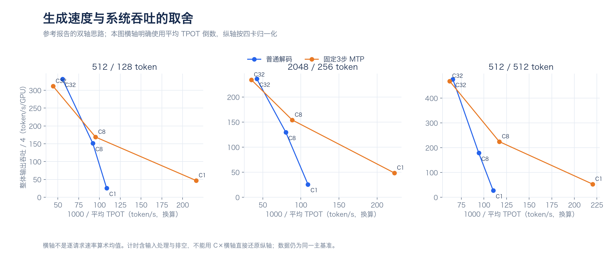

**图 3　生成速度与每GPU系统输出吞吐。** 参考PDF的双轴展示方式，但横轴明确为平均TPOT倒数，纵轴为四卡整体吞吐/4；与参考PDF的逐用户生成速率均值不完全同义。不能用C×横轴还原纵轴，也不能据此比较两种框架优劣。

### 5.3 输入桥接与中间并发补测

**表 11　用于缩小边界的补测**

| 输入/输出 | C | 普通tok/s | MTP tok/s | 配对比均值 | 逐轮范围 / 解释 |
|---|---|---|---|---|---|
| 512/128 | 16 | 956.14 | 850.82 | 0.890× | 0.896/0.887/0.886；边界在C8至C32之间已有反例。 |
| 2048/128 | 8 | 397.39 | 443.00 | 1.115× | 1.111/1.117/1.116；与512/128同输出长度的桥接。 |

### 5.4 独立提示集五轮候选验收

从固定1/2/3步筛选，再冻结batch<32用3步、batch32用1步的已有adaptive映射。候选不改变权重精度、top-k或接受阈值。独立提示集seed31415，每配置五轮×512请求。验收同时要求吞吐至少增5%、TTFT与P99退化不超过5%、零错误及正确性/恢复检查。

**表 12　独立提示集五轮结果；P99合并每配置2560请求**

| 配置 | 输出 tok/s | 相对固定3步 | 平均TTFT ms | TPOT ms | 合并2,560请求P99 ms |
|---|---:|---:|---:|---:|---:|
| 普通解码 | 1115.64 | 0.976× | 803.94 | 22.556 | 3776.07 |
| 固定3步 | 1143.58 | 1.000× | 317.26 | 25.502 | 4287.35 |
| 固定1步 | 1229.93 | 1.076× | 840.73 | 19.580 | 3422.05 |
| 冻结batch映射（<32用3步、32用1步） | 1228.21 | 1.074× | 841.03 | 19.614 | 3457.80 |

固定1步与冻结映射的吞吐约提高7.6%/7.4%，但TTFT比约2.650/2.651，原相对门槛失败；候选不保留。后续TTFT归因解释了到达反馈，但不会追改原门槛或把旧失败写成成功。20项配置/恢复探针通过，只覆盖基本正确性。

分段回放C1→32→8中，固定3步的全wall吞吐545.07 tok/s，仅合并benchmark窗口为679.12；adaptive为554.74/696.71。段间预热和启动间隔不能删掉后仍称真实连续流量。详见[阶段报告](REPORT-MTP-BOUNDARY.md)。

## 6. GPU阶段活动与尚未闭合的成本解释

### 6.1 采集与归一化方法

六个代表配置×四个rank共24份trace，使用SGLang/PyTorch CPU/GPU profiling接口，保留CUDA Graph。Nsight已安装但预检的系统CPU采样受限，当前分析实际使用的是已导出的GPU时间线，不能称已采得Nsight硬件带宽计数器。

CPU范围与kernel用CUDA launch correlation关联；CUDA Graph的同名gpu_user_annotation不重复当作CPU forward次数。kernel时间按rank和阶段取区间并集，再除对应CPU注释次数。未关联kernel保留unknown；scheduler范围包含模型调用和等待，不能当作独立CPU开销。

**表 13　rank0阶段GPU活动/次，不是请求延迟**

| 配置 | 普通decode／验证forward ms/次 | draft ms/次 | draft_extend ms/次 | prefill／decode(verify)注释次数 |
|---|---:|---:|---:|---:|
| short-c1-none | 8.740 | — | — | 1／23 |
| short-c1-mtp | 10.853 | 1.003 | 0.775 | 1／23 |
| short-c32-none | 14.133 | — | — | 8／16 |
| short-c32-mtp | 33.666 | 1.864 | 2.003 | 4／20 |
| long-context-c8-none | 10.048 | — | — | 7／17 |
| long-context-c8-mtp | 18.737 | 1.274 | 1.062 | 1／23 |

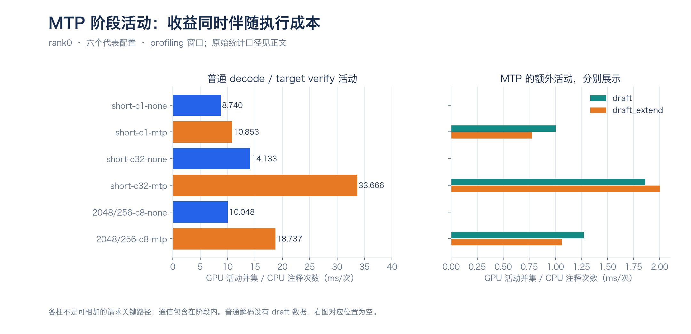

**图 4　普通decode、target verify及额外草稿活动。** 左侧普通/验证活动、右侧draft和draft_extend分别展示；没有堆叠成完整延迟分解。不同配置的prefill次数和batch分布不完全相同。

### 6.2 支持的观察与不能推出的结论

短输入C1中，target verify活动约10.853ms，对照decode约8.740ms；C32则约33.666对14.133ms。请求级平均提交长度约2.880/2.870/2.866（C1/8/32）仍接近，但验证变宽与额外草稿工作可侵蚀净收益。提交长度包含非草稿输出，不是接受概率。

rank0 C32 MTP验证窗口内，通信识别活动约154.47ms，验证活动并集约673.31ms；普通decode为48.03/226.13ms。通信已在阶段内部，且可能与计算重叠，不能把这些数再相加。按名称识别也可能遗漏融合通信。

目前还不能报告“PCIe已经打满”“显存带宽达到理论值多少”或“通信贡献全部延迟的某个百分比”。参考PDF具备其窗口内的kernel家族统计，但这些占比不能直接搬到本项目。下一步需要同batch/上下文、匹配的调度时间线及必要硬件计数器。

## 7. TTFT计时与闭环到达反馈

### 7.1 客户端时间线

原生客户端先获取max_concurrency信号量，再进入HTTP请求函数开始计时。等待客户端名额在旧TTFT之外；服务器排队在TTFT之内。某模式完成更快或更分散，会改变下一批补发的真实到达，形成反馈。


旧独立验证中，固定3步后480请求TTFT约281.74ms，而固定1步约840.10ms；首32请求分别约850.13/850.25ms。按到达间隔>10ms分簇，固定1步更多32请求一簇，固定3步更多小簇。这些是客户端到达簇，不是GPU batch的完整普查。

**表 14　统一到达条件的控制测量**

| 到达条件 | 配置 | 正式请求 | 平均TTFT ms | 服务端queue_time ms | forward起点到prefill完成 ms |
|---|---|---:|---:|---:|---:|
| 单请求 | 普通解码 | 3 | 87.91 | 0.11 | 85.58 |
| 单请求 | 固定1步MTP | 3 | 93.70 | 0.13 | 91.63 |
| 单请求 | 固定3步MTP | 3 | 93.20 | 0.12 | 91.06 |
| 同时32请求 | 普通解码 | 96 | 814.55 | 447.28 | 279.56 |
| 同时32请求 | 固定1步MTP | 96 | 850.70 | 469.29 | 291.31 |
| 同时32请求 | 固定3步MTP | 96 | 849.45 | 468.70 | 290.95 |
| 固定4请求/秒 | 普通解码 | 192 | 93.70 | 0.10 | 84.12 |
| 固定4请求/秒 | 固定1步MTP | 192 | 98.17 | 0.11 | 89.35 |
| 固定4请求/秒 | 固定3步MTP | 192 | 101.16 | 0.12 | 89.13 |

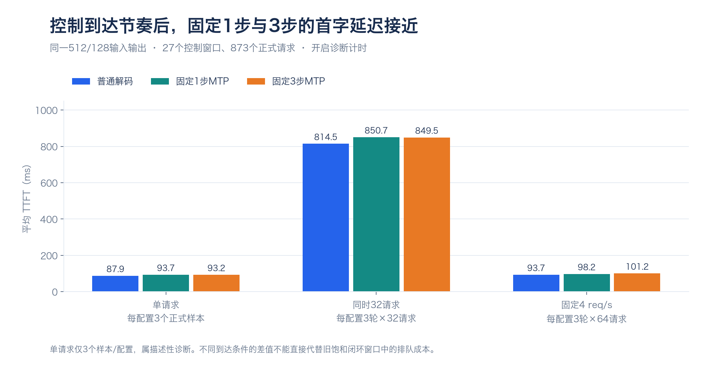

**图 5　统一到达条件下的首字延迟。** 同时32请求的固定1/3步TTFT比1.001，固定4req/s时0.970；单请求每配置仅3样本。此处没有把不同负载的排队均值补填进旧请求。

本轮27窗口、873正式请求，输入512/输出128，temperature0、ignore_eos；三配置都启用metrics与request time stats。首正token事件到首文本最大间隔0.000ms，未观察到空文本解释数百毫秒差异。该结论只覆盖本轮/generate路径。

控制结果支持到达反馈/排队是旧差异的重要因素，未证明框架存在计时bug，也未证明所有TTFT差异都由单一机制造成。新低负载的低TTFT不能替代旧饱和窗口的性能。来源：[诊断报告](REPORT-TTFT-ATTRIBUTION.md)。

## 8. 相同外部到达率下的有效吞吐

### 8.1 预先冻结的达标目标

从“完成一个补一个”的闭环转为绝对周期到达表。512/128、4/7/9req/s，每窗计划30秒、三轮；三轮轮换配置顺序，第2轮到达率反序。同到达率下输入和时间表完全相同，共27窗口、5,400计划请求；216预热另列。外部共同32在途保护超限即拒绝，不改成隐式排队。

**表 15　到达率、有效吞吐、延迟与拒绝**

| 外部到达率 req/s | 配置 | 达标比例 | 有效吞吐 req/s（含排空） | 平均TTFT ms | 平均TPOT ms | 本地拒绝/全部正式请求 | 总输出tok/s | 达标输出tok/s |
|---|---|---|---|---|---|---|---|---|
| 4 | 普通解码 | 100.00% | 3.812 | 94.39 | 20.03 | 0/360 | 487.97 | 487.97 |
| 4 | 固定1步MTP | 100.00% | 3.901 | 99.05 | 10.58 | 0/360 | 499.39 | 499.39 |
| 4 | 固定3步MTP | 100.00% | 3.912 | 101.70 | 9.88 | 0/360 | 500.70 | 500.70 |
| 7 | 普通解码 | 9.84% | 0.642 | 96.01 | 35.06 | 30/630 | 795.47 | 82.20 |
| 7 | 固定1步MTP | 30.16% | 2.010 | 114.03 | 28.60 | 0/630 | 853.22 | 257.32 |
| 7 | 固定3步MTP | 97.14% | 6.473 | 127.94 | 26.48 | 0/630 | 852.95 | 828.58 |
| 9 | 普通解码 | 6.67% | 0.563 | 96.42 | 34.83 | 210/810 | 800.87 | 72.08 |
| 9 | 固定1步MTP | 10.74% | 0.914 | 125.73 | 31.50 | 147/810 | 891.65 | 117.00 |
| 9 | 固定3步MTP | 33.70% | 2.875 | 144.41 | 29.75 | 127/810 | 920.48 | 367.95 |

上表新增tok/s列来自该阶段已核验summary.json的原生output_throughput，另以成功数×128/完整duration_s交叉核对；达标输出用达标数×128/同一时长计算，再取三轮均值。这里的诊断开关和30秒协议属于该阶段，不能与最新600秒/240秒绝对吞吐混合排行。

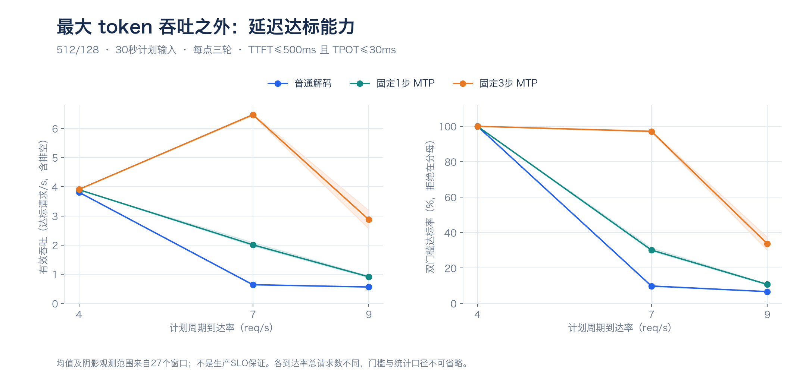

**图 6　有效吞吐与达标比例随到达率变化。** 左图完整观测分母包含排空；右图全部计划请求包含拒绝。阴影为三轮观测范围；仅测试三个有限点，不把最高到达率称为最大容量。

4req/s三模式均100%达标；7req/s固定3步为97.14%，普通9.84%、固定1步30.16%；9req/s三者均明显退化。生成阶段变慢时，首字仍可低于150ms，因此首字快不能覆盖后续生成体验。

### 8.2 在途、时间段与门槛敏感性

7req/s时普通解码平均在途约28.27，固定1步24.97、固定3步23.26；平均首轮queue_time约0.11/0.12/0.15ms。该queue_time不包含整个生成期间的所有等待。普通有30/630本地拒绝，MTP两组该点无拒绝。

同一7req/s原始请求保持TTFT500ms，只测后复算TPOT门槛：

**表 16　测后TPOT目标敏感性，不替换主门槛**

| TPOT目标 | 普通解码达标比例 | 固定1步达标比例 | 固定3步达标比例 |
|---:|---:|---:|---:|
| 25ms | 5.24% | 13.49% | 17.62% |
| 30ms | 9.84% | 30.16% | 97.14% |
| 35ms | 17.62% | 100.00% | 100.00% |

25ms、30ms、35ms可显著改变达标比例和排序，故不能只用某一个研究阈值下的大倍数称为模型计算加速。每轮的请求数/观测时长、首轮队列和计划发送偏差均有原始记录；最大偏差2.135ms，小于冻结100ms门槛。来源：[有效吞吐报告](REPORT-GOODPUT.md)。

## 9. 持续输入、无诊断复验与策略适用范围

### 9.1 120秒持续请求与单参数干预

固定1步下增加prefill_decode_interval=8：extend后设置剩余轮数，在满足min_bs条件时减少计数并暂缓接纳prefill。这里是调度/生成轮次，不是8个输出token。相同512/128、周期7req/s，每配置三轮×840请求。

**表 17　120秒窗口与中心60秒队列**

| 配置 | 全窗口达标比例 | 原生有效吞吐 req/s（含排空） | 中间60秒达标比例 | 中间队列平均TTFT ms | 中间队列平均TPOT ms |
|---|---:|---:|---:|---:|---:|
| 固定1步／间隔0 | 5.67% | 0.392 | 0.24% | 115.03 | 30.40 |
| 固定3步／间隔0 | 95.44% | 6.594 | 96.27% | 129.49 | 27.96 |
| 固定1步／间隔8 | 100.00% | 6.927 | 100.00% | 245.86 | 17.01 |

候选的prefill日志更多合并2个新请求，中心TTFT约245.86ms而固定1步约115.03；TPOT从30.40降到17.01ms。SSE chunk可含多个token，chunk间隔P95和按token均摊间隔不能冒充GPU逐token时间。日志统计含预热，不是完整kernel普查。

本轮全部配置开启时间统计与日志，候选减少prefill日志条数也可能减少部分日志成本。因此设计独立无诊断复验，不能直接声称无日志服务也得到同幅度收益。

### 9.2 已完成的63窗口夜间复验

原模型与三配置，关闭metrics、时间统计和请求日志。阶段A为512/128、7req/s周期到达、600秒×三轮；阶段B用300秒窗口，比较周期/指数到达与不同长度。共104,940计划请求、102,806成功、2,134本地拒绝，无未预期服务/网络错误。

**表 18　600秒阶段A的无诊断复验**

| 配置 | 已完成轮次 | 计划请求 | 达标比例 | 中间60%到达队列达标比例 | 有效吞吐req/s（含排空） | 平均TTFTms | 平均TPOTms |
|---|---:|---:|---:|---:|---:|---:|---:|
| 固定1步／间隔0 | 3/3 | 12600 | 1.13% | 0.03% | 0.079 | 115.15 | 30.35 |
| 固定3步／间隔0 | 3/3 | 12600 | 95.74% | 96.10% | 6.681 | 130.31 | 27.96 |
| 固定1步／间隔8 | 3/3 | 12600 | 100.00% | 100.00% | 6.982 | 244.68 | 16.97 |

固定1步/interval8相对原固定3步，平均配对有效吞吐1.045倍（逐轮1.039–1.054），首字等待约1.878倍；不能把相对固定1步低基线的88.910倍goodput理解为模型计算同倍数加速。

**表 19　300秒阶段B：不同长度和到达轨迹完整汇总**

| 负载 | 配置 | 已完成轮次 | 请求数 | 达标比例 | 有效吞吐req/s | 本地拒绝 |
|---|---|---:|---:|---:|---:|---:|
| B-context-periodic | 固定1步／间隔0 | 3/3 | 3600 | 2.36% | 0.094 | 0 |
| B-context-periodic | 固定3步／间隔0 | 3/3 | 3600 | 1.67% | 0.066 | 0 |
| B-context-periodic | 固定1步／间隔8 | 3/3 | 3600 | 0.94% | 0.037 | 465 |
| B-context-poisson | 固定1步／间隔0 | 3/3 | 3591 | 44.03% | 1.746 | 200 |
| B-context-poisson | 固定3步／间隔0 | 3/3 | 3591 | 37.62% | 1.491 | 195 |
| B-context-poisson | 固定1步／间隔8 | 3/3 | 3591 | 0.67% | 0.026 | 462 |
| B-decode-periodic | 固定1步／间隔0 | 3/3 | 1350 | 100.00% | 1.483 | 0 |
| B-decode-periodic | 固定3步／间隔0 | 3/3 | 1350 | 100.00% | 1.486 | 0 |
| B-decode-periodic | 固定1步／间隔8 | 3/3 | 1350 | 100.00% | 1.483 | 0 |
| B-decode-poisson | 固定1步／间隔0 | 3/3 | 1341 | 100.00% | 1.466 | 0 |
| B-decode-poisson | 固定3步／间隔0 | 3/3 | 1341 | 100.00% | 1.464 | 0 |
| B-decode-poisson | 固定1步／间隔8 | 3/3 | 1341 | 100.00% | 1.466 | 0 |
| B-short-periodic | 固定1步／间隔0 | 3/3 | 6300 | 2.29% | 0.159 | 0 |
| B-short-periodic | 固定3步／间隔0 | 3/3 | 6300 | 95.95% | 6.676 | 0 |
| B-short-periodic | 固定1步／间隔8 | 3/3 | 6300 | 100.00% | 6.965 | 0 |
| B-short-poisson | 固定1步／间隔0 | 3/3 | 6198 | 85.83% | 5.869 | 389 |
| B-short-poisson | 固定3步／间隔0 | 3/3 | 6198 | 93.09% | 6.366 | 301 |
| B-short-poisson | 固定1步／间隔8 | 3/3 | 6198 | 87.22% | 5.965 | 122 |

短输入随机到达中候选87.22%低于固定3步93.09%；长输入周期到达候选平均首字约6.45秒，累计465拒绝；指数轨迹约5.71秒、462拒绝。512/512@1.5req/s三种配置均100%达标，属于低负载点，不证明最大容量。

中心60%队列按到达时刻截取600秒中的120–480秒，跟踪完整生命周期，避免末尾排空误导，但仍不是无限时间稳态。

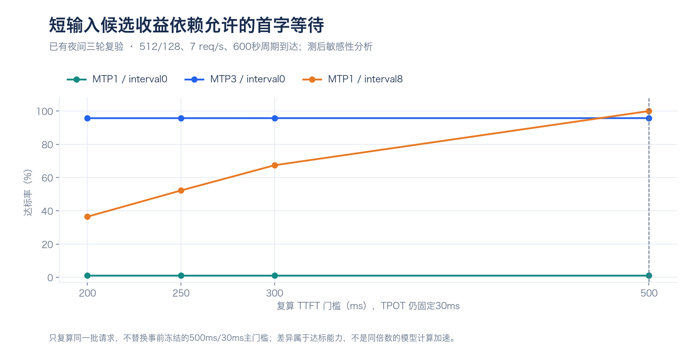

**图 7　短输入候选对TTFT目标的敏感性。** 相同请求，TPOT门槛固定30ms；若首字要求300ms，interval8达标约67.42%，低于固定3步95.74%。这项为测后补充，事前500ms/30ms仍是主验收。

## 10. 四配置、等待预算、时间线与续块保护

### 10.1 补齐MTP步数×调度间隔

固定1/3步×interval0/8，短512/128@7req/s与长2048/128@4req/s各120秒，共8窗口5,280计划请求。关闭诊断；单固定顺序、单轮，只作初筛。

**表 20　四配置初筛：短输入**

| 配置 | 计划/成功 | 达标比例 | 有效吞吐req/s | 平均TTFT ms | 平均TPOT ms | P99 TTFT ms | 拒绝 |
|---|---:|---:|---:|---:|---:|---:|---:|
| 固定1步 / 间隔0 | 840/840 | 5.48% | 0.378 | 115.11 | 30.02 | 131.80 | 0 |
| 固定3步 / 间隔0 | 840/840 | 92.62% | 6.383 | 130.12 | 27.86 | 152.22 | 0 |
| 固定1步 / 间隔8 | 840/840 | 100.00% | 6.908 | 246.10 | 16.96 | 368.73 | 0 |
| 固定3步 / 间隔8 | 840/840 | 78.81% | 5.433 | 370.22 | 18.56 | 564.56 | 0 |

**表 21　四配置初筛：长输入**

| 配置 | 计划/成功 | 达标比例 | 有效吞吐req/s | 平均TTFT ms | 平均TPOT ms | P99 TTFT ms | 拒绝 |
|---|---:|---:|---:|---:|---:|---:|---:|
| 固定1步 / 间隔0 | 480/480 | 6.67% | 0.263 | 194.33 | 30.30 | 205.66 | 0 |
| 固定3步 / 间隔0 | 480/480 | 3.96% | 0.156 | 218.25 | 37.25 | 238.47 | 0 |
| 固定1步 / 间隔8 | 480/432 | 2.50% | 0.094 | 5693.04 | 17.87 | 7109.19 | 48 |
| 固定3步 / 间隔8 | 480/393 | 1.46% | 0.054 | 7366.45 | 13.70 | 8733.35 | 87 |

3步/interval8短输入达标78.81%，低于原3步/interval0的92.62%；长输入TTFT约7.37秒并拒绝87/480。增加推测步数没有消除延后prefill的首字问题。不同负载同时改变长度和到达率，不从跨行差异归因长度的单独效果。

### 10.2 100ms等待预算与同步开销

在协调rank用入队时间与perf_counter决定是否停止主动延后，CPU TP组广播共同决定；从属rank不能用各自时钟分叉。只包装冻结摘要的Scheduler方法，不改安装源码；离线四进程Gloo验证时刻意偏移时钟并验证异常传播。预算不抢占正在执行的GPU，也不是完整TTFT上限。

设置原3步/0、1步/8、1步/8仅同步、1步/8同步+100ms四组，将同步与预算分开。短长各120秒，共8窗口5,280计划请求。

**表 22　100ms预算长输入控制结果**

| 配置 | 计划/成功 | 达标比例 | 有效吞吐req/s | 平均TTFT ms | 平均TPOT ms | P99 TTFT ms | 拒绝 |
|---|---:|---:|---:|---:|---:|---:|---:|
| 原固定3步 / 间隔0 | 480/480 | 3.96% | 0.156 | 218.62 | 37.36 | 239.44 | 0 |
| 固定1步 / 间隔8 | 480/432 | 2.29% | 0.086 | 5696.05 | 17.88 | 7110.28 | 48 |
| 固定1步 / 间隔8，仅同步 | 480/432 | 2.50% | 0.094 | 5695.86 | 17.88 | 7109.28 | 48 |
| 固定1步 / 间隔8，预算100ms | 480/480 | 7.08% | 0.279 | 378.52 | 39.63 | 440.28 | 0 |

相对仅同步，预算使TTFT5695.86→378.52ms、拒绝48→0，但TPOT17.88→39.63ms，双门槛仅7.08%。长输入中心60%达标仍0%。短输入预算组100%达标，TTFT224.18ms、TPOT23.46ms；这不改写旧相对TTFT退化≤5%门槛。

### 10.3 时间线与分块试验

采样的48步中，interval8有5次输入/43次验证，预算与interval0均12次/36次，验证batch分布不同。完整2048输入单次GPU活动约150ms；据此测试2048/1024分块，保持MTP1、interval8、100ms预算和广播不变。每配置无采样120秒+采样120秒，总4窗口、1,920计划请求、8rank trace。

**表 23　分块对照无采样结果**

| 分块 | 计划/成功 | 平均首字 ms | 平均逐token ms | 双门槛达标 | 有效吞吐req/s | 拒绝 |
|---|---:|---:|---:|---:|---:|---:|
| 2048-token分块 | 480/480 | 352.58 | 40.36 | 4.79% | 0.189 | 0 |
| 1024-token分块 | 480/441 | 626.98 | 57.02 | 0.21% | 0.008 | 39 |

1024单次target输入GPU活动由150.38降至94.21ms，但48步采样中输入次数12→27、验证次数36→21，实际batch和上下文也变化。缩短单次输入活动未带来端到端收益；不同trace覆盖时长不同，不能把次数解释为每秒频率。

### 10.4 纳入未完成续块的预算保护

源码核对发现：请求入选后移出waiting_queue，未完成部分保存在chunked_req；旧100ms策略只看waiting_queue。只改变protect_chunked布尔值，MTP1、interval8、chunk1024、100ms其余一致。

**表 24　续块预算无采样配对**

| 预算集合 | 计划/成功 | 平均首字ms | 平均逐tokenms | 双门槛达标 | 有效吞吐req/s | 拒绝 |
|---|---:|---:|---:|---:|---:|---:|
| 仅普通等待队列 | 480/441 | 625.77 | 57.31 | 0.21% | 0.008 | 39 |
| 普通队列加未完成续块 | 480/442 | 395.19 | 57.46 | 2.08% | 0.082 | 38 |

**表 25　续块保护的中心60%队列（采样与无采样分开）**

| 集合 | 窗口 | 计划/成功 | 平均首字ms | 平均逐tokenms | 达标 | 拒绝 | 输入停止前成功完成 |
|---|---|---:|---:|---:|---:|---:|---:|
| 仅普通等待队列 | clean | 288/262 | 630.08 | 58.66 | 0.00% | 26 | 262/262 |
| 仅普通等待队列 | profile | 288/213 | 759.90 | 73.20 | 0.00% | 75 | 213/213 |
| 普通队列加未完成续块 | clean | 288/264 | 396.29 | 58.88 | 0.00% | 24 | 264/264 |
| 普通队列加未完成续块 | profile | 288/220 | 729.09 | 70.60 | 0.00% | 68 | 220/220 |

纳入续块改善首字，TPOT和拒绝基本未变；续块原入队时间包含已经完成的输入计算，定义为首次响应前预算年龄，不是纯排队等待。源码遗漏在有界干预中有影响，但不能说它解释1024全部退化。于是转向无竞争单请求成本与原生interval0负载的独立研究。

采样扰动单列：1024无采样成功441/480，而其profiler窗口390/480；不能把两者平均作性能结论。自动停止后多余stop请求曾返回500，其采样自动结束与文件有效性分别验收，不隐去控制接口失败。

## 11. 最新完成：分块成本隔离与600秒独立执行

### 11.1 第二次执行的设计和真实完成范围

最终采用第二次执行`run-20261031T152137Z-attempt02-fresh`。三配置均原生interval0、无调度补丁、无profiler；每条实际入服务请求新建一次连接，零复用、不重试POST。本地拒绝不发HTTP。第一次失败单独保留，未混入本节均值。

A：相同16输入，输出1和128，ABBA四服务block（2048、1024、1024、2048），每block32请求；共128正式请求。B：三个配置×四种负载×三轮，每窗600秒=36窗口、75,108计划请求。合计40case、75,236计划请求、73,291成功、1,945本地拒绝，未预期错误为0；8次smoke和328预热另外计数。

**表 26　第二次独立执行配置与负载**

| 维度 | 设置 | 控制方式 |
|---|---|---|
| 配置 original3 | MTP3 / chunk2048 / interval0 | 原默认对照。 |
| 配置 one2048 | MTP1 / chunk2048 / interval0 | 与原对照比较推测深度。 |
| 配置 one1024 | MTP1 / chunk1024 / interval0 | 与one2048比较分块；不能与原对照同时归因单变量。 |
| 短输入周期 | 512/128 @4req/s，600秒2400计划请求 | 每轮同负载跨配置输入/时间表相同。 |
| 长输入低率周期 | 2048/128 @2req/s，600秒1200计划请求 | 低竞争条件。 |
| 长输入周期 | 2048/128 @4req/s，600秒2400计划请求 | 高生成压力。 |
| 长输入指数 | 2048/128，标称4req/s；逐轮2345/2397/2294请求 | 实际计划率约3.908/3.995/3.823req/s。 |
| 顺序与seed | 配置按拉丁轮转；轮间重排输入与随机seed | 负载顺序仍固定，不消除所有时间/温度干扰。 |
| 有效性 | 发送偏差≤100ms；实际最大5.723ms | 实际输出长度、零retraction、连接trace分别核验。 |

### 11.2 A：完整服务block结果

**表 27　ABBA微测每个block与输出长度**

| 服务block | 输出token | 正式请求 | 首正token ms | 首文本 ms | 平均TPOT ms |
|---|---|---|---|---|---|
| A-b1-one2048 | 1 | 16 | 165.558 | 165.558 | 不定义 |
| A-b1-one2048 | 128 | 16 | 165.351 | 165.351 | 5.8538 |
| A-b2-one1024 | 1 | 16 | 205.088 | 205.088 | 不定义 |
| A-b2-one1024 | 128 | 16 | 204.336 | 204.336 | 5.8528 |
| A-b3-one1024 | 1 | 16 | 205.215 | 205.215 | 不定义 |
| A-b3-one1024 | 128 | 16 | 204.463 | 204.463 | 5.8515 |
| A-b4-one2048 | 1 | 16 | 165.930 | 165.930 | 不定义 |
| A-b4-one2048 | 128 | 16 | 165.790 | 165.790 | 5.8535 |

**表 28　先在配置内平均两个block，再按同输入求1024减2048**

| 输出token | 成对输入 | 首正token差ms | 首文本差ms | TPOT差ms |
|---|---|---|---|---|
| 1 | 16 | +39.408 | +39.408 | 不定义 |
| 128 | 16 | +38.829 | +38.829 | -0.0015 |

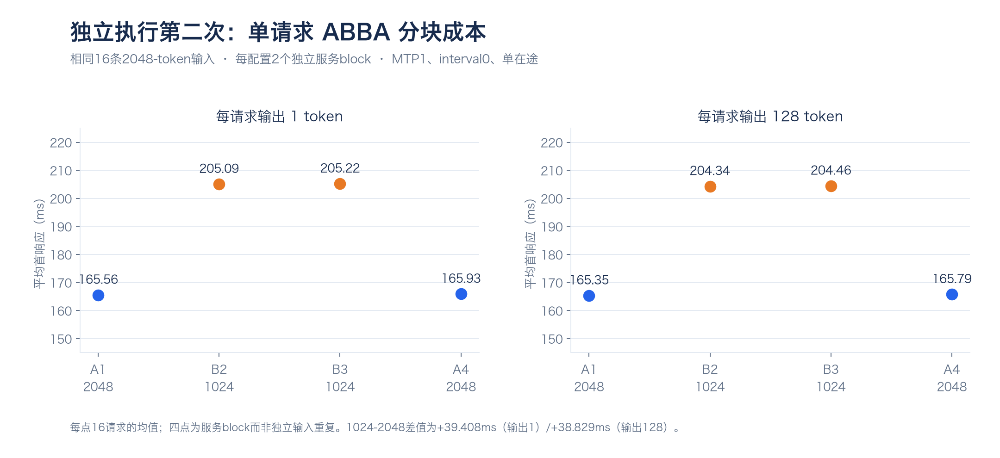

**图 8　第二次独立执行的ABBA微测。** 每点是独立服务block内16请求均值；每配置只有2block，不把16条输入称为16次独立服务重复。输出1不计算TPOT。

结论限定为：无竞争decode、MTP1/interval0下，分两块1024仍有约39ms额外客户端首响应成本，输出128时TPOT几乎相同。客户端包括连接、CPU和服务处理，不能直接称GPU固定开销，更不能独立拆出上下文续算、通信或具体调度函数占比。

### 11.3 B：四负载×三配置×三轮结果

下表先对每个服务窗口内的请求求均值，再对三个窗口等权平均；括号为三个窗口的最小值—最大值。达标率也先逐窗计算；延迟仅覆盖成功请求，拒绝仍在全部计划分母。完整逐轮36行见附录B。

**表 29　600秒负载窗口三轮等权汇总**

| 负载（req/s） | 配置 | TTFT ms | TPOT ms（范围） | 达标率%（范围） | 逐轮拒绝 |
|---|---|---|---|---|---|
| 512/128 周期4 | MTP3/chunk2048 | 100.66 | 9.77 (9.71–9.86) | 100.00% (100.00–100.00) | 0/0/0 |
| 512/128 周期4 | MTP1/chunk2048 | 98.56 | 10.59 (10.53–10.68) | 100.00% (100.00–100.00) | 0/0/0 |
| 512/128 周期4 | MTP1/chunk1024 | 98.55 | 10.60 (10.55–10.68) | 100.00% (100.00–100.00) | 0/0/0 |
| 2048/128 周期2 | MTP3/chunk2048 | 180.78 | 6.60 (6.59–6.60) | 100.00% (100.00–100.00) | 0/0/0 |
| 2048/128 周期2 | MTP1/chunk2048 | 178.13 | 8.88 (8.88–8.88) | 100.00% (100.00–100.00) | 0/0/0 |
| 2048/128 周期2 | MTP1/chunk1024 | 215.46 | 9.76 (9.75–9.76) | 100.00% (100.00–100.00) | 0/0/0 |
| 2048/128 周期4 | MTP3/chunk2048 | 219.04 | 37.89 (37.87–37.92) | 0.82% (0.79–0.83) | 0/0/0 |
| 2048/128 周期4 | MTP1/chunk2048 | 198.57 | 33.84 (30.64–40.24) | 1.32% (1.25–1.38) | 0/0/0 |
| 2048/128 周期4 | MTP1/chunk1024 | 248.92 | 59.65 (59.59–59.74) | 0.42% (0.42–0.42) | 203/202/201 |
| 2048/128 指数标称4 | MTP3/chunk2048 | 377.60 | 30.44 (29.41–31.68) | 40.63% (37.09–42.63) | 108/105/77 |
| 2048/128 指数标称4 | MTP1/chunk2048 | 360.84 | 29.07 (27.75–30.80) | 45.69% (40.05–49.52) | 113/102/81 |
| 2048/128 指数标称4 | MTP1/chunk1024 | 502.54 | 37.77 (36.23–39.72) | 21.14% (17.15–23.23) | 262/265/226 |

**同一36个夜间负载窗口的tok/s评价补充（不新增测量）：**

| 负载 | 配置 | 平均 T_out tok/s | 三轮 T_out范围 | 平均 G_out tok/s |
|---|---|---|---|---|
| 512/128 周期4req/s | MTP3 / chunk2048 | 511.50 | 511.49–511.51 | 511.50 |
| 512/128 周期4req/s | MTP1 / chunk2048 | 511.41 | 511.41–511.41 | 511.41 |
| 512/128 周期4req/s | MTP1 / chunk1024 | 511.41 | 511.40–511.41 | 511.41 |
| 2048/128 周期2req/s | MTP3 / chunk2048 | 255.87 | 255.86–255.87 | 255.87 |
| 2048/128 周期2req/s | MTP1 / chunk2048 | 255.81 | 255.81–255.81 | 255.81 |
| 2048/128 周期2req/s | MTP1 / chunk1024 | 255.79 | 255.79–255.79 | 255.79 |
| 2048/128 周期4req/s | MTP3 / chunk2048 | 510.93 | 510.92–510.95 | 4.19 |
| 2048/128 周期4req/s | MTP1 / chunk2048 | 511.02 | 510.90–511.09 | 6.74 |
| 2048/128 周期4req/s | MTP1 / chunk1024 | 467.74 | 467.54–467.92 | 2.13 |
| 2048/128 指数标称4req/s | MTP3 / chunk2048 | 478.74 | 471.73–488.02 | 202.68 |
| 2048/128 指数标称4req/s | MTP1 / chunk2048 | 478.34 | 470.87–488.70 | 227.81 |
| 2048/128 指数标称4req/s | MTP1 / chunk1024 | 445.84 | 440.21–453.73 | 105.31 |

每窗成功输出由原始completion_tokens/实际output_len核对，时长取保存的duration_s。长输入周期4req/s下MTP1/2048的三轮T_out为511.09、511.08、510.90tok/s，TPOT却由约30.65升至40.24ms：在固定到达率、全部成功的条件下，总输出近似不变不足以说明单请求同样快。1024出现拒绝，T_out均值467.74tok/s；G_out同时揭示三配置绝大多数请求尚未同时满足500ms/30ms。

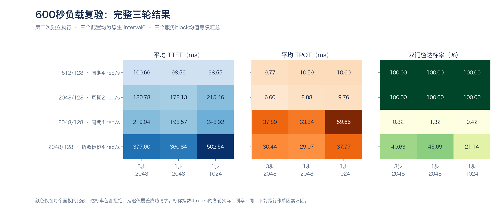

**图 9　三轮完整负载结果矩阵。** 每个面板独立色标；颜色不能跨指标比较。短输入/低率全部达标，长输入4req/s受生成耗时限制。成功集合因拒绝不同，需与附录中的计划数共同解读。

高负载周期下，1024配置三轮分别拒绝203/202/201，请求TPOT59.5867/59.6393/59.7360ms；另外两配置没有本地拒绝。三配置三轮中心60%到达队列达标率均0%，全窗口少量达标集中于开始/结束，不能当作持续运行已达标。

指数负载中，MTP1/2048三轮平均达标45.69%，MTP3/2048为40.63%，MTP1/1024为21.14%；有限轨迹下有差异，但三轮actual offered不同、拒绝也改变准入速率，不将周期/指数跨行差值认定为“只改变到达分布”的因果效应。

### 11.4 第三轮变化与逐分钟证据

MTP1/chunk2048长输入周期负载，TPOT前两轮30.6385/30.6515ms，第三轮40.2443ms，高于同轮原配置37.8997ms。第三轮所有2400请求成功、无拒绝，最大发送偏差约2.08ms，token和零retraction通过，因此不是100ms发送门槛失败。

按计划到达分钟选cohort，第0分钟约30.50ms，第2–8分钟约41.77–42.55ms。cohort统计其完整生成生命周期，而非该分钟瞬时GPU速度。

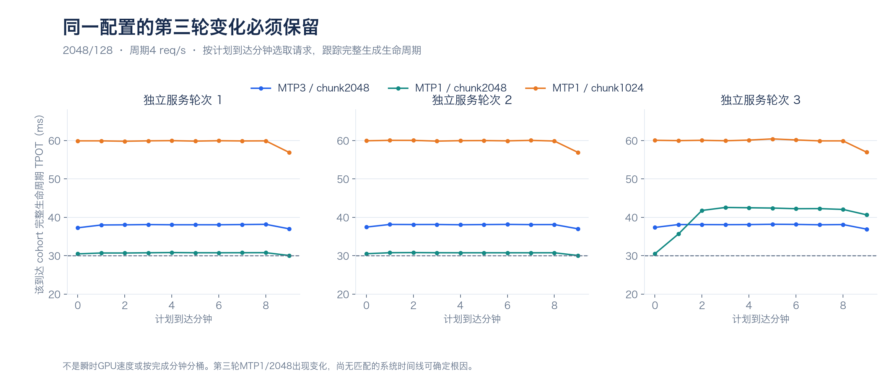

**图 10　长输入周期负载的逐分钟TPOT。** 分别保留三个独立服务轮次；第三轮one2048的运行状态变化没有被均值隐藏。虚线是研究TPOT30ms。未采匹配系统/调度时间线，根因未定。

可能相关的输入排列、批处理、温度或通信等因素当前未独立隔离；不能选一个解释写为已确认原因。下一项应围绕第三轮变化的单一问题设计有界诊断，不继续盲扫参数。来源：[晨间最终报告](REPORT-NIGHT-ISOLATION-2026-11-01.md)。

### 11.5 后续离线审计：服务端报告与在途变化

证据截止2026-11-01T12:44:05+08:00，使用同一第二次执行的冻结记录；复核36个负载窗口、75,108既有计划请求，重点三轮MTP1/chunk2048长输入周期窗口的7,200条请求。新增GPU请求0，不增加独立重复数量。

| 观察量 | 第1轮 | 第2轮 | 第3轮 |
|---|---:|---:|---:|
| 服务端上报平均E2E（s） | 4.085949 | 4.087474 | 5.314048 |
| 客户端减服务端平均计时（ms） | 1.0291 | 1.0379 | 1.0360 |
| 每请求验证次数／正确草稿／提出草稿 | 64/64/64 | 64/64/64 | 64/64/64 |
| 中心120–480s客户端在途（时间加权） | 16.4044 | 16.4006 | 22.2949 |

第三轮相对前两轮，服务端上报E2E增加1227.337ms，客户端总耗时增加1227.340ms；两套计时差几乎不变。额外时间体现在服务端报告，但不等于纯GPU时间。7,200条请求的输出128、缓存0、回退0、验证次数和草稿计数均一致，削弱“接受工作数量退化”解释；不排除单轮验证更慢或穿插/等待增加。

按88种共同输入身份先在轮内平均，第三轮对每一种输入均慢于前两轮均值，输入等权增加1227.746ms，各输入增加1074.685–1332.346ms；输出文本hash一致。输入顺序和动态上下文仍不同，不能把身份对齐当作随机因果试验。

客户端在途从时间戳的半开区间重建，事件积分与逐请求裁剪求和独立一致。在途及首字后未完成代理不是实际GPU batch，也不能决定在途上升和耗时上升的因果方向。第三轮90–100s到达组的TPOT升至约38.33ms、100–110s约41.57ms；按完整生命周期分组，不能把90s当精确调度变点。

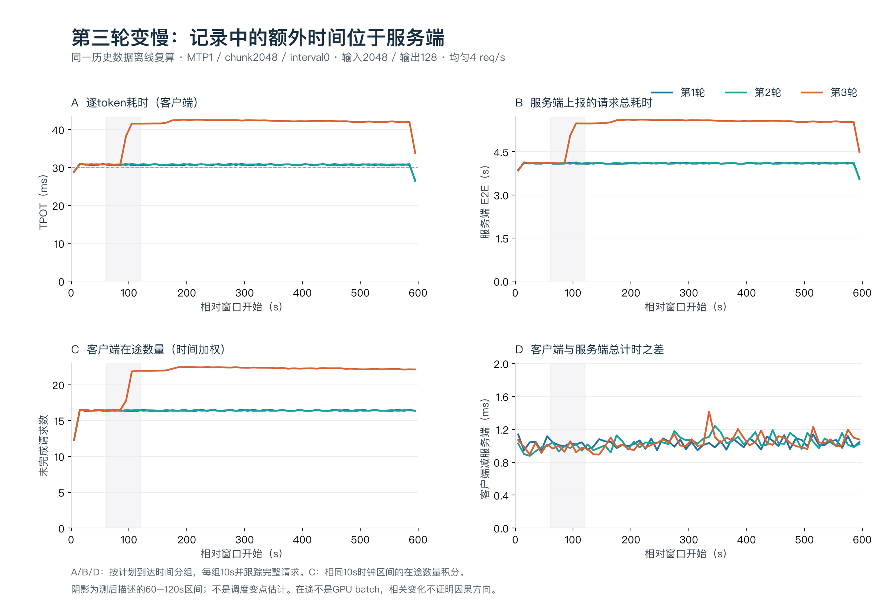

本次291份输入证据hash分析前后保持一致。[阶段报告](REPORT-DRIFT-AUDIT-2026-11-01.md)保留逐输入、10秒分组和两张PNG/PDF；[下一次最小诊断设计](results/drift-audit-2026-11-01/run-20261101T044359Z/NEXT-DIAGNOSTIC.md)在该离线检查点尚未执行，随后已按11.6完成ABBA短诊断。设计只保留一个配置和负载，以ABBA原输入顺序对照先验证复现，再按测前条件最多触发一个48步诊断窗口；不得将profile结果与clean结果合并。

### 11.6 单配置输入顺序ABBA短时在线诊断（完成）

2026-11-01 14:18:42启动，14:41:22结束并恢复原服务，14:42:45独立验收通过。4/4个240秒clean窗口、3840次正式计划请求全部成功，无本地拒绝、无未预期请求错误；额外8冒烟和40预热单列。每block独立重启固定MTP1/chunk2048/interval0，2048/128、均匀4req/s，输入顺序A/B为旧第1/3轮前960条原定义。与旧协议的区别是短窗口和新增1Hz四卡监测，不合并为同一实验。

| block | 输入顺序 | TPOT ms | 服务端E2E s | 中心时段客户端在途（时间加权） |
|---|---|---:|---:|---:|
|clean1-A|A|40.9928|5.4003|21.8871|
|clean2-B|B|30.3203|4.0446|16.3114|
|clean3-B|B|30.3529|4.0490|16.3256|
|clean4-A|A|30.4140|4.0570|16.3508|

同一个A顺序两次出现40.9928与30.4140ms，说明输入顺序身份不足以单独确定快慢。所有3840条请求记录的验证次数与正确/提出草稿数均为64/64/64，输出128、缓存0、回退0。共同成功输入的输出文本hash一致；客户端在途仍是代理，不能当GPU batch或确定因果方向。

四个窗口都未满足测前冻结的连续3组<33ms紧接3组>35ms取证门槛，因此未追加profile。观察到慢状态，不等于复现旧窗口先低后高转变；门槛未触发也不等于完全无异常。没有为取得trace而放宽门槛或追加窗口，真实profile计数0。

**同一4个clean窗口的输出吞吐（tok/s）：**

| 窗口 | 实际成功输出token | 完整计时s | T_out tok/s | G_out tok/s |
|---|---|---|---|---|
| clean1-A | 122,880 | 241.259994 | 509.33 | 11.14 |
| clean2-B | 122,880 | 241.078941 | 509.71 | 14.87 |
| clean3-B | 122,880 | 241.078078 | 509.71 | 15.93 |
| clean4-A | 122,880 | 241.076308 | 509.71 | 15.40 |

四窗都成功输出122,880token，计时约241秒、包含末尾排空，故T_out均约509–510tok/s；这是周期4req/s约束下的交付率，不是最大服务容量。clean1-A与clean4-A虽有约41/30.4ms的TPOT差，T_out只约509.33/509.71tok/s。不能因总吞吐接近否认快慢状态；也不能把相对“快”写成30ms研究门槛全部达标。

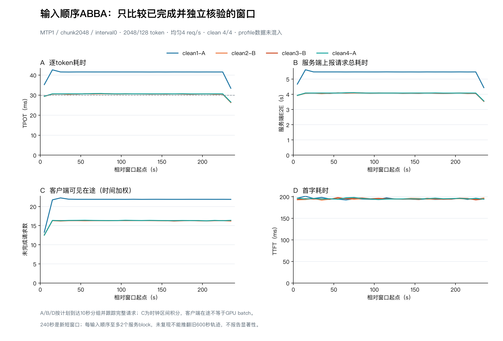

原固定3步/interval0/chunk2048恢复，PID1056981；实际argv、UUID归属、环境清理、health/models、中文/算术、安装源码和全量测试通过，执行器退出、锁释放。服务器预检与两次最终各163项测试通过；本地163项中161通过、2项远端连接集成测试明确跳过。72份文件、7610801字节逐项远端SHA256/大小匹配；无未回收正式请求。根因仍未确定，下一步围绕快/慢状态取实际调度batch及输入/验证交错，不继续把输入顺序当唯一解释。[阶段报告](REPORT-DRIFT-DIAGNOSTIC-2026-11-01.md)。

## 12. 失败记录、正确性与服务恢复

**表 30　保留的失败、排除与机制边界**

| 事件 | 原始记录 / 影响 | 处理和当前判断 |
|---|---|---|
| 既有夜间首次600秒窗口 | 4200请求成功，但2请求发送偏差>100ms，最大约255ms。 | 排除窗口、恢复原服务；GC移出正式区间作为共同控制，不宣称GC是确定根因。 |
| 四配置初筛第一次 | 保存8请求smoke时cases空目录缺失；0正式窗口。 | 只修目录初始化，回归通过后第二次，保留截止和门槛。 |
| profiling stop重复调用 | 自动停止后冗余stop返回500。 | 原始控制失败保留，按自动停止及四rank完整文件验收。 |
| 最新首次分块执行 | 状态failed；15正式case/22818请求通过审计；失败窗2345=2081成功+263拒绝+1连接断开。 | 失败窗不并入第二次。历史socket缺连接trace，复用仅是支持的假设。 |
| 第二次连接修订 | 实际入服务每请求新连接，零复用、不重试POST；离线Unix socket故障注入。 | 验证修订作用机制与本轮传输路径，不反推第一次精确根因。 |
| 第二次第三轮变化 | one2048周期长输入TPOT升至40.24ms。 | 保留数据，未采匹配系统时间线，不称配置一致就应结果相同。 |

### 12.1 质量验证覆盖

早期中文与算术、候选20项smoke，以及最新微测相同输入文本hash一致，都属于局部正确性检查。最新B同轮同负载36组配置两两比较中，共同成功请求的解码文本hash全部一致；被拒绝的请求不进入等价结论。这不等于tokenID逐位一致或广泛语义质量等价。

### 12.2 夜间阶段恢复与回收记录（历史）

2026-11-01 05:48恢复原TP4/MTP3/interval0/chunk2048，05:51:15独立验收通过；05:53:32闭环确认执行器结束、锁释放、无遗留实验客户端、环境覆盖清理、安装源码不变、health200。最终记录于06:02:47定稿。当时的详细报告整理未重新验收远端；最新短时诊断验收另见12.3。

远端最终与独立最终各148项测试通过；本地148项测试中2项aiohttp连接集成测试明确跳过并在远端执行。287稳定文件、95,146,527字节逐项与远端SHA256/大小匹配。恢复后滚动服务日志按05:53:32截取70,931字节校验，此后追加日志不属于本次回收范围。锁、临时文件、滚动audit、manifest自身按清单排除。

全部40正式case结束，无未完成窗口、无未回收正式请求。**实验队列完成不等于科研机制已解释完**，第三轮变化仍列未解决。

### 12.3 最新短时诊断恢复与回收

2026-11-01 14:41:22恢复原固定3步/interval0/chunk2048，14:42:45独立验收，14:44:45进一步实时核验通过。PID1056981，执行器结束、锁可用，无遗留实验客户端。72份文件共7,610,801字节与远端大小和SHA256逐项匹配；恢复服务日志按最终捕获时刻固定字节前缀。全量163项服务器测试通过，本地163项含2项明确跳过的远端集成测试。4个正式窗口全部完成，条件profile门槛未触发，真实profile窗口0。[完成记录](results/drift-diagnostic-2026-11-01/run-20261101T061222Z/completion.json)。

## 13. 复现步骤、完整数据与证据组织

### 13.1 复现入口

以下用于说明复现流程，不代表已经再次执行这些示例；本次已授权的短时在线诊断另在11.6记录。公开副本只包含选定汇总；需原始复算时先恢复相应原件并核对清单。任何新测量都应使用新run目录，先确认现有服务和资源范围，不覆盖已完成结果。

```bash
# 基础单点复测示例；参数先经现有服务检查
.venv/bin/python scripts/bench_suite.py \
  --tag verification-YYYYMMDD-01 --input-len 512 --output-len 128 \
  --concurrency 1 --num-prompts 52 --warmup-requests 8 --seed 42

# 主基准已有证据复算；使用已保存run目录，不重启GPU服务
python3 scripts/mtp_analysis.py --run-dir results/mtp-study-2026-10-30/run-20261030T070100Z/baseline-remote \
  --output-dir /tmp/mtp-analysis-review

# 本报告十张新图；只读冻结派生JSON，不访问模型
python3 tools/render_progress_figures.py

# 本地代码验证；它不能替代GPU实测
python3 -m unittest discover -s tests
```

主基准控制脚本为`mtp_experiment.py`，GPU采集为`mtp_profile.py`，阶段分析为`mtp_analysis.py`；新夜间工作流、请求传输、独立审计分别保存在`night_isolation.py`、`night_isolation_fresh_worker.py`、`night_isolation_audit.py`及该run的code-snapshot中。执行旧协议时以冻结code-snapshot为准，不能用当前脚本无说明替换。

新夜间`analysis/FINAL-SUMMARY.json`、`analysis/arrival-minute-cohorts.json`、`audit-transport-local.json`、`retrieval-verified-final.json`、`completion.json`分别对应聚合、分钟分组、传输核验、回收和结束状态。历史脚本会写审计或执行状态，文档复核优先只读原始文件和冻结汇总，避免误触运行逻辑。

### 13.2 本报告数据与图表的审计链

本次吞吐补充采用独立的[throughput-summary.json](results/throughput-review-2026-11-01/throughput-summary.json)，保存夜间36窗、短时4窗各自的实际输出token、完整时长、T_out/G_out和源hash；[口径说明](results/throughput-review-2026-11-01/README.md)解释固定到达率限制与微测混合输出边界。既有冻结图表数据保持原样。

[report-data.json](results/work-report-2026-11-01/report-data.json)保存基准、逐轮夜间结果、分钟cohort、图表数据及源文件SHA256；[图表说明](results/work-report-2026-11-01/README.md)列出十张图和统计方式。原阶段报告的本次只读副本保存在同目录`sources/`，避免后续持续维护时无法找回本次采用的版本。

派生汇总与源hash可追溯，不等于公开库含完整原始请求。每次报告更新须重新核对最新完成状态和scope，不把旧21:46在途检查点延用为11月1日完成事实；旧检查点仍保留为历史。

### 13.3 参考PDF的范围差异与未覆盖项目

**表 31　参考报告与本项目的对齐边界**

| 维度 | 参考PDF | 本项目现状 |
|---|---|---|
| 模型/框架 | Flash0731 revision7872f…；vLLM0.32.0；DSpark7 | Flash revision60d8…；SGLang0.5.23；MTP1/3。仅参考记录粒度。 |
| 长度/缓存 | 8K至1M输入、1024输出；冷/共享前缀 | 主基准512/128、2048/256、512/512，关闭缓存；无对齐长上下文扫描。 |
| 模块分析 | 其Nsight指定窗口kernel家族累计时间 | 本项目rank局部阶段活动，不能复制对方占比。 |
| API与成本 | DeepInfra/Relace/Wafer及当时价格、四卡租金 | 本项目未测这些API，未冻结实际计费口径；不借用$10/小时算成本。 |
| 理论极限 | 其报告提出后续通信/索引优化变量 | 本项目未测带宽饱和/完整roofline，没有理论百分比。 |
| 图表横纵轴 | 用户生成速率与token/s/GPU等明确单位 | 本文标明TPOT倒数、四卡合计或每GPU；客户端与聚合定义分别保留。 |

## 14. 研究判断、局限与下一步

**表 32　证据如何改变工作判断**

| 起始假设 / 目标 | 新增证据 | 保留判断 / 下一步 |
|---|---|---|
| 浅推测可提升吞吐 | 独立验证约+7.5%，但旧TTFT相对门槛失败。 | 不部署；先统一到达过程。 |
| 固定1步固有首字变慢2.65倍 | 统一到达下比值接近1。 | 到达反馈重要，不改写旧负载失败。 |
| interval8适合全局 | 周期短输入获益，随机/长输入反例。 | 明确业务长度与SLO；限定策略适用范围。 |
| 更小分块减少阻塞 | 单次活动变短但次数增，端到端退化。 | 测无竞争总成本，避免只看单kernel。 |
| 续块覆盖可解决全部问题 | 首字改善，TPOT/拒绝接近。 | 只解释部分影响，不称全因果。 |
| 1024额外成本来自负载竞争 | 无竞争ABBA仍多约39ms；高负载TPOT也更高。 | 分开讨论固定客户端/服务路径成本与负载交错。 |
| MTP1/2048高负载稳定优于MTP3 | 第三轮TPOT40.24ms，反高于原37.90ms。 | 保留运行状态变化；优先单问题诊断，不推广候选。 |

**表 33　后续问题与所需证据**

| 优先级 | 问题 | 下一项最小证据 | 尚不应声称 |
|---|---|---|---|
| P0 | 相同顺序何以出现不同快慢状态？ | ABBA短诊断已完成，同A出现40.99/30.41ms反例；旧转变门槛未触发。下一项取证需明确覆盖快/慢状态的实际batch与输入/验证交错。 | 宣称输入顺序已被完全排除，或把客户端在途当GPU batch。 |
| P1 | 额外39ms由哪些路径组成？ | 相同输入、服务block和上下文下的CPU/调度/GPU相关时间线。 | 全部39ms是GPU固定开销。 |
| P1 | 业务真正需哪种达标目标？ | 冻结输入输出长度、到达轨迹、缓存、延迟目标后再比较。 | 500ms/30ms为已确认业务SLO。 |
| P2 | 能否与同学或vLLM公平对照？ | 先对齐模型revision、精度、长度、缓存和客户端口径，再做最小公共测点。 | 当前216或188超过某人160就代表框架更强。 |
| P2 | 接近硬件上限了吗？ | 关键路径、硬件计数器、模型/批量内存流量估算及受控通信干预。 | PCIe打满或达到理论性能某百分比。 |

上述是研究待办，不表示本次获准或已经追加GPU负载。候选仍不推广；先把单一未解释变化形成可审查的诊断问题，再决定下一轮。只有三轮服务block与有限固定语料，没有生产P99、无限稳态、跨模型/硬件泛化或广泛任务质量证明。

## 15. 长期报告与日报共同维护

长期文档持续维护本文件：每次新增实验或判断变化，更新环境、协议、结果表、图、失败记录、证据截止时间与下一步。短期文档以用户每天明确指定的截止为准，未指定默认北京时间当日17:00；起点承接上一份日报的已确认截止，用户另定起点时优先。截止后的当天下午、晚间至24:00工作归入次日日报，次日凌晨到新截止继续记入同一份；午夜不切换。

每天同时维护两者：长期文档组织累计研究脉络，日报写实际当期新增；数字、状态、结论与证据截止时间一致。后续正式性能对照同时记录实际成功输出token、完整duration_s、T_out（tok/s）、TTFT、TPOT与拒绝；使用延迟门槛时另列G_out（tok/s）和达标率。采样窗口明确标记扰动，不与clean性能合并。阶段报告保留完整方法，派生图标明单位、是否含排空、按GPU归一化、独立重复数、误差线定义。旧负面/失败记录不会因新报告重写而删除。

本次11月1日日报明确覆盖10月31日17:00至11月1日15:01:27，状态已收口；旧暂定16:30作废。科学证据仍采用各阶段自身截止：夜间06:02:47、离线12:44:05、短诊断14:46:43，不能把日报登记时刻写成实验再次完成或实时服务验收。下一周期已在11月2日日报承接，今天后续新结果不再追加到已收口日报。

公开发布采用选定报告、当期日报、派生数据和已视觉审查的图片共同更新，不整库同步私有历史、原始请求或凭据。发布清单核对文件hash；本次报告更新本身不等于GPU实验复现或当前服务检查。

**表 34　文档更新记录**

| 文档更新日期 | 工作周期 | 变更与状态 |
|---|---|---|
| 2026-10-31 | 2026-11-01 | 初建累计报告，采用21:46:23在途检查点。该快照作为历史保留。 |
| 2026-11-01 | 2026-11-01 | 按参考PDF粒度扩充环境、协议、完整测点、模块活动、复现与失败恢复；新增10图；采用06:02:47最终记录替换在途判断，并同步日报。 |
| 2026-11-01 | 2026-11-01收口 | 纳入12:44离线审计与14:46短诊断；按用户指定范围10月31日17:00至11月1日15:01:27完成日报收口，后续工作转11月2日，默认截止规则改为17:00。 |

## 附录A. 主基准18组完整模式均值

同一54窗口的派生表。每行3轮；TTFT、TPOT和E2E先逐轮请求平均后等权汇总。吞吐范围为三轮最小值–最大值，E2E均值不是P99。

**表 35　主基准完整模式测点**

| 输入/输出 | C | 模式 | 三轮完成N | 整体tok/s | 三轮吞吐范围 | TTFT ms | TPOT ms | E2E ms |
|---|---|---|---|---|---|---|---|---|
| 512/128 | 1 | 普通 | 156 | 101.85 | 101.63–102.07 | 87.11 | 9.208 | 1256.48 |
| 512/128 | 1 | MTP3 | 156 | 187.70 | 187.33–187.95 | 94.18 | 4.626 | 681.67 |
| 512/128 | 8 | 普通 | 600 | 605.00 | 604.33–605.65 | 310.69 | 10.873 | 1691.56 |
| 512/128 | 8 | MTP3 | 600 | 675.55 | 674.01–676.71 | 173.72 | 10.496 | 1506.73 |
| 512/128 | 32 | 普通 | 1152 | 1325.57 | 1324.95–1325.93 | 796.93 | 18.030 | 3086.75 |
| 512/128 | 32 | MTP3 | 1152 | 1246.28 | 1245.78–1246.59 | 390.88 | 22.631 | 3265.00 |
| 2048/256 | 1 | 普通 | 96 | 102.82 | 102.66–103.02 | 156.72 | 9.148 | 2489.50 |
| 2048/256 | 1 | MTP3 | 96 | 194.05 | 193.92–194.15 | 173.68 | 4.490 | 1318.52 |
| 2048/256 | 8 | 普通 | 264 | 518.61 | 517.86–519.25 | 768.45 | 12.467 | 3947.45 |
| 2048/256 | 8 | MTP3 | 264 | 617.15 | 616.57–617.72 | 423.53 | 11.294 | 3303.54 |
| 2048/256 | 32 | 普通 | 480 | 944.45 | 944.25–944.62 | 2613.68 | 23.746 | 8668.87 |
| 2048/256 | 32 | MTP3 | 480 | 937.87 | 934.63–939.70 | 1392.73 | 28.622 | 8691.35 |
| 512/512 | 1 | 普通 | 96 | 108.35 | 108.04–108.63 | 88.41 | 9.074 | 4725.06 |
| 512/512 | 1 | MTP3 | 96 | 212.25 | 212.18–212.37 | 91.57 | 4.541 | 2411.91 |
| 512/512 | 8 | 普通 | 192 | 714.20 | 713.65–714.58 | 311.51 | 10.610 | 5733.34 |
| 512/512 | 8 | MTP3 | 192 | 898.50 | 898.10–898.98 | 171.56 | 8.553 | 4541.95 |
| 512/512 | 32 | 普通 | 480 | 1905.61 | 1902.83–1907.27 | 799.18 | 15.253 | 8593.39 |
| 512/512 | 32 | MTP3 | 480 | 1876.08 | 1875.21–1876.55 | 422.47 | 16.139 | 8669.75 |

## 附录B. 最新600秒负载36个服务窗口

每行是一个独立服务配置的一轮600秒负载窗；本表的计数可相加得到本轮阶段B计数，但不能再与前文12组均值重复相加。达标率是本窗口成功且同时满足门槛的请求数/全部计划数。

**表 36　最新独立执行逐轮完整测点**

| 负载 | 轮 | 配置 | 计划/成功 | 拒绝 | TTFT ms | TPOT ms | 达标率 | 中心60%达标率 | T_out tok/s | G_out tok/s |
|---|---|---|---|---|---|---|---|---|---|---|
| 512/128 周期4 | 1 | MTP3/chunk2048 | 2400/2400 | 0 | 100.18 | 9.7501 | 100.00% | 100.00% | 511.51 | 511.51 |
| 512/128 周期4 | 1 | MTP1/chunk2048 | 2400/2400 | 0 | 96.94 | 10.5267 | 100.00% | 100.00% | 511.41 | 511.41 |
| 512/128 周期4 | 1 | MTP1/chunk1024 | 2400/2400 | 0 | 97.79 | 10.5532 | 100.00% | 100.00% | 511.41 | 511.41 |
| 512/128 周期4 | 2 | MTP3/chunk2048 | 2400/2400 | 0 | 102.66 | 9.8582 | 100.00% | 100.00% | 511.49 | 511.49 |
| 512/128 周期4 | 2 | MTP1/chunk2048 | 2400/2400 | 0 | 97.93 | 10.5686 | 100.00% | 100.00% | 511.41 | 511.41 |
| 512/128 周期4 | 2 | MTP1/chunk1024 | 2400/2400 | 0 | 97.20 | 10.5749 | 100.00% | 100.00% | 511.41 | 511.41 |
| 512/128 周期4 | 3 | MTP3/chunk2048 | 2400/2400 | 0 | 99.16 | 9.7133 | 100.00% | 100.00% | 511.49 | 511.49 |
| 512/128 周期4 | 3 | MTP1/chunk2048 | 2400/2400 | 0 | 100.79 | 10.6843 | 100.00% | 100.00% | 511.41 | 511.41 |
| 512/128 周期4 | 3 | MTP1/chunk1024 | 2400/2400 | 0 | 100.67 | 10.6832 | 100.00% | 100.00% | 511.40 | 511.40 |
| 2048/128 周期2 | 1 | MTP3/chunk2048 | 1200/1200 | 0 | 180.61 | 6.6048 | 100.00% | 100.00% | 255.86 | 255.86 |
| 2048/128 周期2 | 1 | MTP1/chunk2048 | 1200/1200 | 0 | 178.14 | 8.8798 | 100.00% | 100.00% | 255.81 | 255.81 |
| 2048/128 周期2 | 1 | MTP1/chunk1024 | 1200/1200 | 0 | 215.51 | 9.7568 | 100.00% | 100.00% | 255.79 | 255.79 |
| 2048/128 周期2 | 2 | MTP3/chunk2048 | 1200/1200 | 0 | 180.91 | 6.5965 | 100.00% | 100.00% | 255.87 | 255.87 |
| 2048/128 周期2 | 2 | MTP1/chunk2048 | 1200/1200 | 0 | 178.08 | 8.8833 | 100.00% | 100.00% | 255.81 | 255.81 |
| 2048/128 周期2 | 2 | MTP1/chunk1024 | 1200/1200 | 0 | 215.44 | 9.7540 | 100.00% | 100.00% | 255.79 | 255.79 |
| 2048/128 周期2 | 3 | MTP3/chunk2048 | 1200/1200 | 0 | 180.83 | 6.5897 | 100.00% | 100.00% | 255.87 | 255.87 |
| 2048/128 周期2 | 3 | MTP1/chunk2048 | 1200/1200 | 0 | 178.18 | 8.8801 | 100.00% | 100.00% | 255.81 | 255.81 |
| 2048/128 周期2 | 3 | MTP1/chunk1024 | 1200/1200 | 0 | 215.43 | 9.7549 | 100.00% | 100.00% | 255.79 | 255.79 |
| 2048/128 周期4 | 1 | MTP3/chunk2048 | 2400/2400 | 0 | 218.94 | 37.8658 | 0.83% | 0.00% | 510.92 | 4.26 |
| 2048/128 周期4 | 1 | MTP1/chunk2048 | 2400/2400 | 0 | 195.89 | 30.6385 | 1.33% | 0.00% | 511.09 | 6.81 |
| 2048/128 周期4 | 1 | MTP1/chunk1024 | 2400/2197 | 203 | 249.23 | 59.5867 | 0.42% | 0.00% | 467.54 | 2.13 |
| 2048/128 周期4 | 2 | MTP3/chunk2048 | 2400/2400 | 0 | 219.06 | 37.9179 | 0.83% | 0.00% | 510.93 | 4.26 |
| 2048/128 周期4 | 2 | MTP1/chunk2048 | 2400/2400 | 0 | 195.77 | 30.6515 | 1.38% | 0.00% | 511.08 | 7.03 |
| 2048/128 周期4 | 2 | MTP1/chunk1024 | 2400/2198 | 202 | 248.39 | 59.6393 | 0.42% | 0.00% | 467.76 | 2.13 |
| 2048/128 周期4 | 3 | MTP3/chunk2048 | 2400/2400 | 0 | 219.14 | 37.8997 | 0.79% | 0.00% | 510.95 | 4.04 |
| 2048/128 周期4 | 3 | MTP1/chunk2048 | 2400/2400 | 0 | 204.06 | 40.2443 | 1.25% | 0.00% | 510.90 | 6.39 |
| 2048/128 周期4 | 3 | MTP1/chunk1024 | 2400/2199 | 201 | 249.15 | 59.7360 | 0.42% | 0.00% | 467.92 | 2.13 |
| 2048/128 指数标称4 | 1 | MTP3/chunk2048 | 2345/2237 | 108 | 383.58 | 30.2287 | 42.17% | 44.65% | 476.47 | 210.65 |
| 2048/128 指数标称4 | 1 | MTP1/chunk2048 | 2345/2232 | 113 | 366.76 | 28.6555 | 47.51% | 50.94% | 475.45 | 237.30 |
| 2048/128 指数标称4 | 1 | MTP1/chunk1024 | 2345/2083 | 262 | 512.95 | 37.3505 | 23.03% | 25.87% | 443.58 | 115.00 |
| 2048/128 指数标称4 | 2 | MTP3/chunk2048 | 2397/2292 | 105 | 380.89 | 31.6763 | 37.09% | 38.04% | 488.02 | 189.29 |
| 2048/128 指数标称4 | 2 | MTP1/chunk2048 | 2397/2295 | 102 | 363.91 | 30.7988 | 40.05% | 41.24% | 488.70 | 204.42 |
| 2048/128 指数标称4 | 2 | MTP1/chunk1024 | 2397/2132 | 265 | 504.21 | 39.7157 | 17.15% | 17.59% | 453.73 | 87.47 |
| 2048/128 指数标称4 | 3 | MTP3/chunk2048 | 2294/2217 | 77 | 368.33 | 29.4096 | 42.63% | 48.81% | 471.73 | 208.10 |
| 2048/128 指数标称4 | 3 | MTP1/chunk2048 | 2294/2213 | 81 | 351.84 | 27.7533 | 49.52% | 54.17% | 470.87 | 241.71 |
| 2048/128 指数标称4 | 3 | MTP1/chunk1024 | 2294/2068 | 226 | 490.45 | 36.2293 | 23.23% | 28.76% | 440.21 | 113.46 |

## 附录C. 图表索引与证据入口

**表 37　本文新增图及统计来源**

| 图 | 内容 | 证据 |
|---|---|---|
| [图1](results/work-report-2026-11-01/figures/01-baseline-throughput.png) | 三种长度吞吐/并发 | 54主基准窗口 |
| [图2](results/work-report-2026-11-01/figures/02-baseline-latency.png) | TTFT/TPOT并发曲线 | 与图1重叠 |
| [图3](results/work-report-2026-11-01/figures/03-generation-throughput-tradeoff.png) | TPOT倒数/每GPU吞吐 | 与图1重叠 |
| [图4](results/work-report-2026-11-01/figures/04-gpu-stage-activity.png) | rank0阶段活动 | 六配置profile；非延迟分解 |
| [图5](results/work-report-2026-11-01/figures/05-ttft-arrival-control.png) | 统一到达TTFT | 27控制窗口 |
| [图6](results/work-report-2026-11-01/figures/06-goodput-arrival-rate.png) | 外部到达有效吞吐 | 27窗口，含排空 |
| [图7](results/work-report-2026-11-01/figures/07-slo-sensitivity.png) | TTFT门槛敏感性 | 既有600秒复验测后复算 |
| [图8](results/work-report-2026-11-01/figures/08-chunk-abba.png) | ABBA微测block | 第二次执行阶段A |
| [图9](results/work-report-2026-11-01/figures/09-night-load-matrix.png) | 600秒完整结果矩阵 | 第二次执行阶段B |
| [图10](results/work-report-2026-11-01/figures/10-night-minute-cohorts.png) | 逐到达分钟变化 | 图9子集，不增实验数 |

- [报告冻结数据与源hash](results/work-report-2026-11-01/report-data.json)
- [图表与数据说明](results/work-report-2026-11-01/README.md)
- [最新实验最终阶段报告](REPORT-NIGHT-ISOLATION-2026-11-01.md)
- [早期MTP边界报告](REPORT-MTP-BOUNDARY.md)
- [此前在途证据快照](results/work-report-2026-10-31/progress-snapshot.json)
- [当期日报](daily/2026-11-01.md)与[维护规则](daily/README.md)

参考PDF为本地用户材料，44页，SHA256 `1492f259946383e943c89a3a96cab36cc8ae670e7b5304eca59499344a281094`。仅参考其记录细度与图表结构，原文件不随公开仓库分发。
