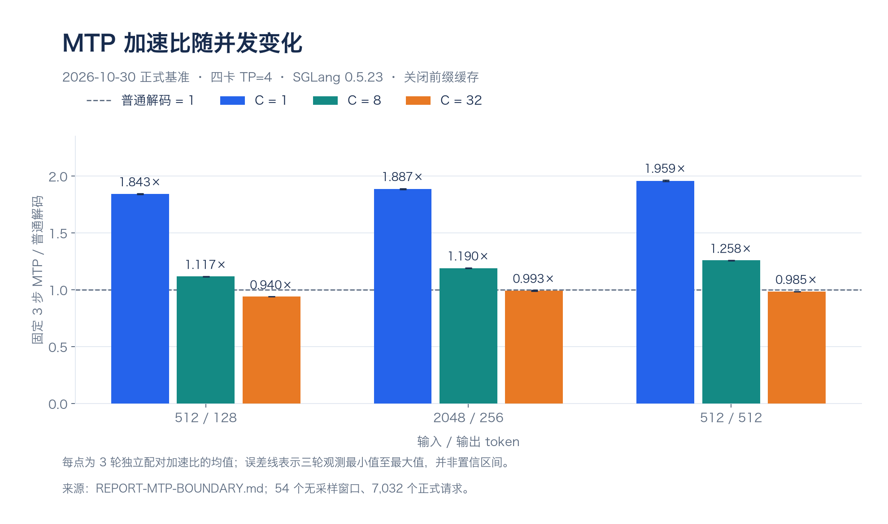

> 公开脱敏副本；环境标识已替换，原始证据另行保留。详见仓库根目录 PUBLICATION.md。

# 2026-10-30 工作日报

工作主线：完成 DeepSeek-V4-Flash / SGLang 四卡部署与受控测量，进一步区分 MTP 的低并发收益、持续负载边界和首 token 延迟的到达过程影响。

本日报按北京时间整理当天完成的阶段。夜间独立复验当晚启动，其完整结果记录在 [10 月 31 日日报](2026-10-31.md)。

## 今日进展

| 工作 | 完成情况 | 主要产出 |
|---|---|---|
| 四卡部署与基础基准 | 完成用户环境预检、普通解码/MTP 和 TP2/TP4 对照，核验原始 token 计数与服务可用性。 | [部署与基准报告](../REPORT.md) |
| MTP 性能边界 | 完成主基准 54 组、补测 12 组、深度筛选 9 组、独立验证 20 组和分段回放 12 组；合计 107 组正式测量、26,776 个正式请求及 24 份 rank trace。 | [MTP 性能边界报告](../REPORT-MTP-BOUNDARY.md) |
| TTFT 与到达节奏归因 | 完成 27 个控制窗口、873 个正式请求，对比闭环、同时到达与固定外部到达率。 | [TTFT 诊断报告](../REPORT-TTFT-ATTRIBUTION.md) |
| 有效吞吐测量 | 冻结 TTFT≤500ms、TPOT≤30ms 的研究门槛，对 4/7/9 req/s 各做三轮比较，共 27 窗口、5,400 个正式计划请求。 | [有效吞吐报告](../REPORT-GOODPUT.md) |
| 持续负载与调度 | 将输入窗口延长至 120 秒，对比固定 1 步、固定 3 步及固定 1 步/间隔 8，共 9 窗口、7,560 个正式计划请求。 | [持续负载报告](../REPORT-SUSTAINED-SCHEDULING.md) |
| 夜间独立复验 | 按冻结方案启动更长窗口、不同输入长度和到达节奏的验证。 | 当晚尚未完成，结果留待次日核验。 |

## 主要结果

各小节按阶段完成或证据形成的顺序展开。标题注明日期与代表时刻；正文补充启动、汇总或验收的具体时间。时间均为北京时间，不把某个完成时刻当作整轮实验的起止，也不把子实验重复累计。

### 01｜10 月 30 日 11:47（配置选定）：先跑通模型，再比较双卡与四卡

2026-10-30上午开展部署和初测；11:47按当时测量选定TP4+MTP，13:30生成回收汇总。现有记录未给出整轮实验统一起止时间，以上分别为配置选定与汇总事件，不表示只在该分钟执行。

#### 为什么做

推理优化要先有一个可信的起点：模型能否在这套硬件上加载并生成回答？两张和四张卡各自能跑到什么水平？先固定环境、模型版本和 token 计数，后面才能比较改动是否有效。

#### 做了什么

固定 DeepSeek-V4-Flash revision，在四张 RTX PRO 6000 范围内完成环境、GPU 可见顺序、卡间访问和内核预检。使用相同受控输入比较普通解码与 MTP，另做 TP2 和较长输入筛选。

各并发分别预热，保存原始 JSONL，检查实际 token 数和成功请求数；中文/算术生成与服务恢复也一并验证。

#### 结果怎样

早期512输入/128输出、四卡三轮均值如下，均为包含输入处理的整体输出吞吐：

| 并发上限 | 普通解码 tok/s | TP4 MTP tok/s | MTP/普通 |
|---|---:|---:|---:|
| 1 | 101.22 | 188.39 | 1.861× |
| 8 | 588.83 | 758.18 | 1.288× |
| 32 | 1288.76 | 1321.95 | 1.026× |

TP2 MTP单副本单轮C1为165.20 tok/s。整个部署阶段回收29份原始JSONL、788次完成请求，成功数、实际输出token与吞吐公式通过核验。上述短窗口与下节扩展基准分别保留。

#### 得出什么结论

模型部署和真实推理可用，MTP在当时单流短测中有明显收益，高并发收益缩小。双卡单副本未超过四卡MTP绝对吞吐，但双卡已跑通，不能说四卡是最低运行要求。两个TP2副本共同服务没有实测，不把单副本结果乘二作为结论。

#### 成果与下一步

形成[部署与基础基准报告](../REPORT.md)、启动/停止/压测及结果校验材料。早期C1仅4个计时请求，下一项扩展长度、并发和重复窗口，验证MTP的收益是否稳定、在哪里消失。

### 02｜10 月 30 日下午至 19:43：测量 MTP 的收益边界，验证浅推测候选

2026-10-30下午开展主基准、补测、内部观察、筛选、独立验证与分段回放；整阶段于**19:43:12完成验收**。各子实验属于同一阶段，未将其完成时刻解释为共同启动时间。

#### 为什么做

初测的单流收益明显，但测点少、窗口短。我们需要确认：换输入和输出长度、提高并发后，MTP 还会更快吗？如果收益消失，是每轮提交的 token 变少了，还是验证等执行成本变高了？

#### 做了什么

主矩阵采用3种输入/输出长度、3个并发、普通/MTP两种模式，各做3轮，共54组、7,032请求。每轮正式计时至少30秒，输入清单、seed、请求数和缓存条件保持配对。

再做12组补测、9组深度筛选、20组独立验证和12组回放，并在六个代表配置采集四个 rank，共24份有效 trace。全阶段合计107组、26,776正式请求，子实验已包含在这个范围内。

#### 结果怎样

在扩展性能边界研究中，固定 3 步 MTP 的单请求吞吐约为普通解码的 1.84～1.96 倍；并发 32 的三种负载均未显示净收益，其中 512/128 负载连续三轮约为普通解码的 0.940 倍。

| 输入 / 输出 token | C=1 MTP/普通 | C=8 MTP/普通 | C=32 MTP/普通 |
|---|---:|---:|---:|
| 512 / 128 | 1.843× | 1.117× | 0.940× |
| 2048 / 256 | 1.887× | 1.190× | 0.993× |
| 512 / 512 | 1.959× | 1.258× | 0.985× |

每点为三轮独立配对加速比的算术均值，误差线为三轮观测最小值至最大值，不是置信区间。虚线 1.0 表示普通解码。图表使用同一套 54 窗口、7,032 个请求的主基准，不是新增实验；不同输入/输出长度间的差异不能归因于单个长度因素。数据见 [MTP 边界绘图汇总](data/2026-10-30-mtp-boundary.json)，方法见 [阶段报告](../REPORT-MTP-BOUNDARY.md)。

补测的512/128、C16配对比约0.890×；固定输出128的2048输入、C8桥接为1.115×。请求级平均每轮提交长度在C1/C8/C32约2.880/2.870/2.866，变化不大；rank0验证GPU活动/次从约10.853ms增至33.666ms，但不是完整请求延迟。

独立提示集五轮中，固定1步输出约1229.93 tok/s，固定3步约1143.58 tok/s；固定1步与冻结batch映射吞吐约改善7.6%/7.4%，但平均TTFT约为原固定3步的2.65倍。分段C1→32→8回放保留总wall与benchmark窗口两种口径，不当作连续线上流量。

#### 得出什么结论

早期部署基准与后续持续测量对应不同实验窗口，分别保留结果，不将早期短窗口数字替代后续结论。候选因 TTFT 超出预设退化门槛而未保留，阶段完成记录显示原固定 3 步 MTP 服务已恢复。

低并发收益不能外推到所有高并发请求；平均提交长度不是草稿接受概率，也不直接等于加速比。局部rank活动不能相加为端到端成本，当前没有证明PCIe或显存带宽饱和。候选未通过预先冻结的相对TTFT退化门槛，不能仅凭吞吐改善替换默认配置。

#### 成果与下一步

保留[MTP性能边界报告](../REPORT-MTP-BOUNDARY.md)、配对测点、24份trace、候选失败与服务恢复证据。下一项先解释“吞吐提高但首字变慢”的矛盾，核对计时和请求到达反馈，而不是继续盲调推测深度。

### 03｜10 月 30 日 20:49（完成）：首字变慢是否来自请求到达方式

2026-10-30开展旧闭环记录审计与控制实验；本阶段于**20:49:08完成**。该时间对应阶段完成记录。

#### 为什么做

固定1步的闭环平均 TTFT 约为固定3步的2.65倍。先不能把这个差异解释成单请求计算天然慢了这么多：闭环采用“完成一条再补一条”，不同模式的完成节奏也会改变后续到达和排队。

#### 做了什么

核对原生客户端信号量与计时起点，检查旧请求的到达分簇；普通、固定1步和固定3步各三轮，分别测试单请求、同时32请求和固定4req/s。共27控制窗口、873正式请求，统一输入512/输出128、时间统计开关与seed。

#### 结果怎样

| 到达条件 | 固定1步TTFT ms | 固定3步TTFT ms | 固定1步/3步 |
|---|---:|---:|---:|
| 单请求 | 93.70 | 93.20 | 接近；每配置仅3个样本 |
| 同时32请求 | 850.70 | 849.45 | 1.001 |
| 固定4req/s | 98.17 | 101.16 | 0.970 |

闭环负载中固定 1 步平均 TTFT 约为固定 3 步的 2.65 倍。统一为同时到达 32 请求后，该比值为 1.001；固定 4 req/s 到达时为 0.970。这支持到达过程和排队是旧差异的重要影响因素，尚不能据此认定单请求固有计算成本增加或框架计时存在错误。

同时32请求时两种MTP的首轮queue_time均约469ms；固定4req/s时接近零。新请求的首正token与首个非空文本未出现数百毫秒错位。

#### 得出什么结论

相同并发上限不等于相同外部到达过程。控制实验支持闭环反馈与排队参与旧差异，但不证明框架计时存在错误，也不能把低负载结果补填进旧饱和请求。旧候选按旧门槛未通过的事实保留。

#### 成果与下一步

形成[TTFT诊断报告](../REPORT-TTFT-ATTRIBUTION.md)，明确客户端等待并发名额不在旧TTFT内、服务器排队在其内。下一项改用相同外部时间表，评价同时满足首字和生成要求的请求数。

### 04｜10 月 30 日 22:26（完成）：相同到达率下，有多少请求真正达标

2026-10-30执行固定外部到达率矩阵，于**22:26:00完成**；每轮正式发送窗口30秒，末尾请求继续排空并纳入计时。

#### 为什么做

系统能输出很多 token，不代表用户既能及时看到首字，又能顺畅收到后续内容。因此给各配置施加相同的到达时间表，检查到底有多少请求同时满足两项延迟要求，并把拒绝也留在评价里。

#### 做了什么

固定512/128，比较普通、MTP1、MTP3；周期到达率4/7/9req/s，每点3轮，共27窗口、5,400正式计划请求。测前冻结TTFT≤500ms、TPOT≤30ms；共同32在途上限触发即本地拒绝，不延后补发。

#### 结果怎样

| 到达率 req/s | 普通达标率 | MTP1达标率 | MTP3达标率 | MTP3有效吞吐 req/s（含排空） |
|---|---:|---:|---:|---:|
| 4 | 100.00% | 100.00% | 100.00% | 3.912 |
| 7 | 9.84% | 30.16% | 97.14% | 6.473 |
| 9 | 6.67% | 10.74% | 33.70% | 2.875 |

7req/s的普通解码首字约96ms，但TPOT约35ms且有30次本地拒绝。测后将TPOT门槛从30改35ms，可把同批MTP1达标率从30.16%改为100%；这属于验收目标变化，不是模型突然算快。

#### 得出什么结论

首字快不等于整个回答体验好。MTP3在本矩阵的有效吞吐较好，但9req/s仍只有33.70%达标，不能把最高测试点当可靠容量。500ms/30ms是研究门槛，未确认为业务SLO；请求有效吞吐req/s、总输出tok/s与TPOT需要分别解释。

#### 成果与下一步

形成[有效吞吐报告](../REPORT-GOODPUT.md)和固定时间表、共同拒绝规则、独立复算方法。下一项延长窗口，观察积压及输入处理是否频繁打断生成，并检验调度间隔候选。

### 05｜10 月 30 日 23:23（完成）：延长窗口，调整输入与生成的调度节奏

2026-10-30将输入窗口延长至120秒，于**23:23:01完成**；后续无诊断夜间独立复验当晚启动，完整结果归入10月31日报。

#### 为什么做

30秒窗口较短，还看不清持续输入时的积压。固定1步在较高到达率下生成变慢，我们想试试：处理一批输入后，先让已有请求多生成几轮，再接纳新输入，能否改善体验？

#### 做了什么

固定512/128、周期7req/s，比较MTP1/间隔0、MTP3/间隔0、MTP1/间隔8；每配置三轮、每窗840请求，共9窗、7,560计划请求。保留SSE事件、输入日志和中心60秒到达队列，完整生命周期与排空分开解释。

#### 结果怎样

| 配置 | 全窗口达标率 | 有效吞吐 req/s | 中心队列TTFT ms | 中心队列TPOT ms |
|---|---:|---:|---:|---:|
| MTP1 / 间隔0 | 5.67% | 0.392 | 115.03 | 30.40 |
| MTP3 / 间隔0 | 95.44% | 6.594 | 129.49 | 27.96 |
| MTP1 / 间隔8 | 100.00% | 6.927 | 245.86 | 17.01 |

全窗口达标与中心队列时延属于不同统计集合。间隔8的日志更多合并两个新请求，输入处理机会减少；该日志含预热，不当作完整GPU普查。

后续实验采用相同输入和相同外部时间表，统计同时满足首字与生成延迟门槛的请求比例，拒绝也计入未达标分母。持续输入实验保留中心队列统计和输入/生成调度观察，短输入候选收益继续交由夜间复验确认。

#### 得出什么结论

本负载下候选改善生成与达标率，同时首字更晚，不能称全面更优。调度间隔是轮次相关配置，不是8个token或固定GPU配额。三组都开时间统计和日志，候选减少日志条数也可能影响开销，需要关闭诊断后独立复验。

#### 成果与下一步

形成[持续负载报告](../REPORT-SUSTAINED-SCHEDULING.md)及事前冻结的MTP1/间隔8候选。下一项做更长窗口、不同长度和周期/随机到达的无诊断复验，主动寻找反例；不能只凭本短输入结果推广。

## 问题与限制

- 固定版本、四卡 TP=4、受控输入输出长度和关闭前缀缓存构成本轮范围，结论不直接外推至其他硬件、模型或业务流量。
- 500ms/30ms 是冻结的研究门槛，尚未确认为业务 SLO。
- rank 局部 GPU 活动不能直接相加解释端到端延迟，当前仍未确定唯一瓶颈。
- 简单中文和算术探针只验证基本可用性与局部稳定性，不构成完整质量评测。

## 下一步

完成夜间独立复验和原始记录核对，分别查看周期/随机到达、短输入/长输入/长输出下的结果。候选能否保留，需要同时检查 TTFT、TPOT、达标率、拒绝、输出检查和服务恢复，不能只根据 token 吞吐决定。

## 相关记录

- [MTP 阶段完成记录](../results/mtp-study-2026-10-30/run-20261030T070100Z/completion.json)：北京时间 19:43 完成。
- [TTFT 阶段完成记录](../results/ttft-study-2026-10-30/run-20261030T121601Z/completion.json)：20:49 完成。
- [有效吞吐完成记录](../results/goodput-study-2026-10-30/run-20261030T134707Z/completion.json)：22:26 完成。
- [持续负载完成记录](../results/sustained-study-2026-10-30/run-20261030T143405Z/completion.json)：23:23 完成。

上述时间由完成记录的 UTC 时间换算为北京时间。各阶段的请求数分别对应自己的正式窗口，不将其作为统一基准直接合并。
