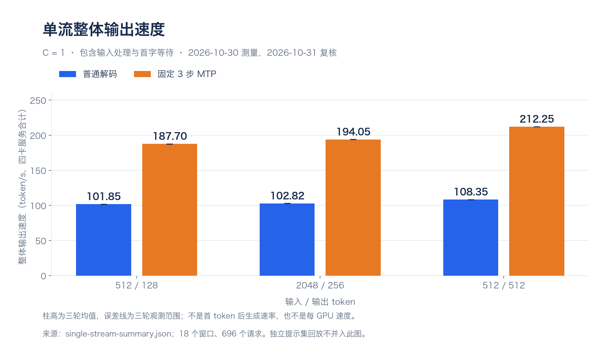
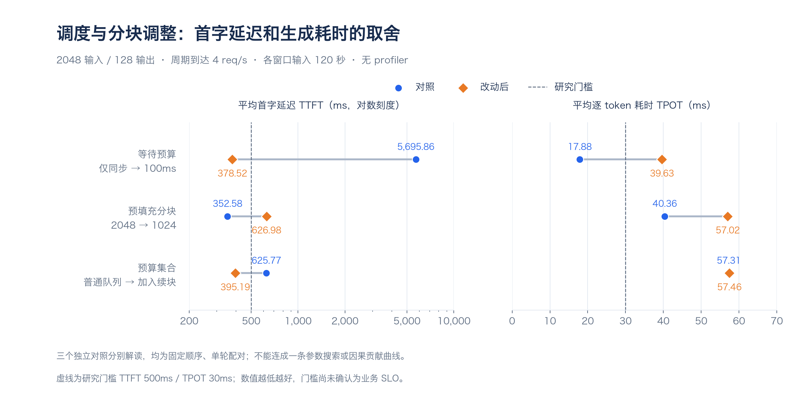

# 2026-10-31 工作日报

工作主线：完成夜间复验，沿长输入首字等待与生成速度之间的取舍，依次检查调度间隔、等待预算、预填充分块和未完成输入续块。

本日报记录截至北京时间 15:34 已完成验收的实验阶段。下文中的服务恢复与测试结果来自各轮验收记录，本次整理未重新运行 GPU 实验或检查远端服务。

## 今日进展

| 完成时间（北京时间） | 工作 | 正式测量范围 | 结果 |
|---|---|---|---|
| 07:07 | 夜间独立复验收尾 | 63 窗口，104,940 个计划请求。 | 短输入周期到达下候选有收益，随机到达与长输入出现反例。 |
| 11:13 | MTP 步数/调度间隔四配置初筛 | 8 窗口，5,280 个计划请求。 | 固定 3 步/间隔 8 未解决长输入首字等待。 |
| 12:07 | 100ms 等待预算原型 | 8 窗口，5,280 个计划请求。 | 首字等待下降，但逐 token 耗时增加。 |
| 13:06 | 长输入时间线诊断 | 6 窗口，2,880 个计划请求，12 份 rank trace。 | 对齐输入处理与验证活动，支持进一步测试预填充分块。 |
| 13:59 | 2048/1024 分块对照 | 4 窗口，1,920 个计划请求，8 份 rank trace。 | 1024 分块单次输入活动变短，端到端结果反而退化。 |
| 15:34 | 续块预算覆盖对照 | 4 窗口，1,920 个计划请求，8 份 rank trace。 | 将未完成续块纳入预算改善 TTFT，生成速度和拒绝数基本未变。 |

完成时间由各轮 `completion.json` 的 UTC 时间换算。窗口中的计划请求包含共同在途上限触发的本地拒绝；诊断采样与无采样结果分别统计。

## 主要结果

### 单流性能口径复核（本次整理，未新增测量）

复核 2026-10-30 已完成的正式三轮基准：四张 RTX PRO 6000 Blackwell Server Edition、TP=4、SGLang 0.5.23、DeepSeek-V4-Flash revision `60d8d70770c6776ff598c94bb586a859a38244f1`，关闭前缀缓存，服务与 kernel 已预热。MTP 使用固定 3 步、top-k=1、4 个 draft token；下表均为客户端并发 C=1。

| 输入 / 输出 token | 普通解码整体输出 tok/s | MTP 整体输出 tok/s | MTP 平均 TTFT ms | MTP 平均 TPOT ms | 由 MTP 平均 TPOT 倒数换算 tok/s |
|---|---:|---:|---:|---:|---:|
| 512 / 128 | 101.85 | 187.70 | 94.18 | 4.626 | 216.17 |
| 2048 / 256 | 102.82 | 194.05 | 173.68 | 4.490 | 222.74 |
| 512 / 512 | 108.35 | 212.25 | 91.57 | 4.541 | 220.23 |

柱高为三轮平均，误差线是三轮观测范围；只展示包含输入处理的整体输出速度，未将 TPOT 倒数混入同一图轴。

整体输出速度按实际输出 token 总数除以 benchmark 完整计时窗口计算，包含输入处理和生成；表内数值为三轮算术均值，吞吐是四卡服务合计。512/128 每种模式共 156 个正式请求，另两种长度每种模式各 96 个；本次共复核 18 份原始 JSONL、696 个请求、187,392 个输出 token，未发现请求错误，成功数、长度、token 总量与吞吐公式一致。

最后一列为 `1000 / 平均 TPOT(ms)`，描述首 token 后生成速度的换算量。它不是逐请求生成速率的算术均值，也未证明与 AIPerf 的生成 TPS 完全等价。不能将 187.70 和 216.17 当作同一指标。

后续独立提示集的固定 3 步 MTP 分段回放，在同为 512/128、C=1 的单轮窗口测到 **181.10 tok/s**，平均 TPOT 4.773ms。该窗口有 52 个请求，属于另一提示集的一段回放，独立保留，不与主基准三轮平均合并。因此，对外说明宜表述为“已有受控单流整体输出约 180～210 tok/s，需同时给出输入/输出长度和提示集”；回答固定 512/128 主基准时使用约 188 tok/s。

证据：[本次原始结果复核](../results/briefing-2026-10-31/single-stream-summary.json)、[三轮主基准与范围](../REPORT-MTP-BOUNDARY.md)。复核记录保存逐文件哈希、轮次和公式；本次未重新压测，也未检查远端实时服务状态。

### 夜间复验确认了收益边界

在短输入 512/128、7 req/s 周期到达、每窗 600 秒、每配置三轮的条件下：

| 配置 | 达标率 | 平均 TTFT | 平均 TPOT |
|---|---:|---:|---:|
| 固定 3 步/间隔 0 | 95.74% | 130.31ms | 27.96ms |
| 固定 1 步/间隔 8 | 100.00% | 244.68ms | 16.97ms |

相同研究门槛下候选生成更快，但首字等待更长。短输入随机到达时，候选达标率为 87.22%，低于固定 3 步的 93.09%；长输入周期到达时，候选首字等待约 6.45 秒。收益不能直接跨输入形状和到达节奏推广。

### 等待预算缓解首字积压，但没有同时满足生成要求

长输入对照中，100ms 预算相对仅同步组将平均 TTFT 从 5695.86ms 降至 378.52ms，本地拒绝从 48 次降为 0 次；平均 TPOT 从 17.88ms 增至 39.63ms，双门槛达标率仍只有 7.08%。预算约束的是策略主动延后，不是完整 TTFT 上限。

### 更小分块和续块保护揭示了不同代价

以下两项分别属于自己的无采样配对窗口，不能将各列当成同一次连续参数搜索：

| 对照 | 平均 TTFT | 平均 TPOT | 本地拒绝 |
|---|---:|---:|---:|
| 分块 2048 → 1024 | 352.58 → 626.98ms | 40.36 → 57.02ms | 0 → 39 |
| 预算仅覆盖普通队列 → 同时覆盖未完成续块 | 625.77 → 395.19ms | 57.31 → 57.46ms | 39 → 38 |

分块对照的时间线确认：单次 target 输入处理活动缩短，但处理次数增加，没有形成当前窗口的端到端收益。随后源码核对发现原等待预算没有显式覆盖 `chunked_req`；对照干预支持续块覆盖影响首次响应，但不足以解释 1024 分块的全部退化。续块覆盖后，中心 60% 请求的双门槛达标率仍为 0%。

### 三组独立对照的延迟取舍

每一行只比较本阶段自己的无采样配对窗口。左图 TTFT 使用对数刻度，右图 TPOT 使用线性刻度；蓝色为对照，橙色为改动后，两项均为越低越好。虚线是 500ms/30ms 的研究门槛。三组对照均为固定顺序单轮，不能作为独立重复或生产容量证明，也不能将三行连成连续参数搜索。

| 独立对照 | TTFT 变化 | TPOT 变化 | 当前判断 |
|---|---:|---:|---|
| 等待预算：仅同步 → 100ms | -93.35% | +121.64% | 首字积压缓解，生成耗时增加。 |
| 预填充分块：2048 → 1024 | +77.83% | +41.28% | 首字、生成和拒绝均退化。 |
| 预算集合：普通队列 → 加入续块 | -36.85% | +0.26% | 首字改善，生成耗时基本未变。 |

数据逐项对应 [绘图汇总及报告来源](data/2026-10-31-latency-tradeoffs.json)。百分比由各组同一指标的两个已公布均值计算，不表示显著性或独立因果贡献。

## 参照材料与组会要求

本次参考 [ChatoyantAI/LLM-Serving-Bench](https://github.com/ChatoyantAI/LLM-Serving-Bench)，固定查看提交 `e8c98d0094896472c7ae68868162e92be205f6a1` 的 README、架构说明与 Nsight 说明。公开仓库主要提供统一评测入口和结果归档协议；其中配置与版本固定、原始结果留存、完成数校验、失败状态保留、profiling 与无采样基线分开记录，纳入本项目的日报维护方式。

用户提供的《DeepSeek V4 Flash 0731 推理实验记录（2026-10-30）》作为实验报告样板：第 1 页先列实验目录和完成范围，第 4～5 页定义负载与指标，第 7～9 页说明图表坐标。原 PDF 为本地参考材料，不随日志复制；文件 SHA-256 为 `1492f259946383e943c89a3a96cab36cc8ae670e7b5304eca59499344a281094`。

组会纪要中的“做了什么、原理是什么、预期效果是什么、最终结果如何”用于完善后续记录模板。各同学的通信占比、80～90/160/170 tok/s 等数字只作背景，不能直接归为本项目实测。

| 对照项目 | 同学 PDF | 本项目现有证据与处理 |
|---|---|---|
| 模型与推理栈 | DeepSeek-V4-Flash-0731，revision `7872f01b1d1fe23eabc4c98b48bffcef5a386062`，vLLM 0.32.0，DSpark | DeepSeek-V4-Flash，revision `60d8d70770c6776ff598c94bb586a859a38244f1`，SGLang 0.5.23，固定 3 步 MTP。不能仅凭速度数值给框架排名。 |
| 负载与缓存 | 主扫描 8K～1M 输入、1024 输出，分别记录冷输入和共享前缀 | 三轮基准为 512/128、2048/256、512/512，前缀缓存关闭；尚无与 PDF 8K/1024 完整对齐的 C1 对照。 |
| 输出图横轴 | 平均单用户生成速度，token/s/用户 | 必须与包含首字等待的整体输出速度分开；平均 TPOT 倒数另行标注。 |
| 输出图纵轴 | 四卡整体输出吞吐除以 4，token/s/GPU | 本项目报告表格默认为四卡整体 tok/s；复刻图形时须明确是否除以 4。 |
| 并发与吞吐关系 | 测点 C 表示客户端并发上限 | 整体计时包含输入处理和排空，不能无条件用 `C × 横轴生成速度` 还原整体吞吐，更不能漏掉每 GPU 的归一化。 |
| 理论极限 | 组会要求分析卡点与理论上限 | 目前未建立可核验的硬件上限模型，也未证明 PCIe 或显存带宽饱和；“达到理论值百分之多少”记为待验证。 |

## 工程与材料整理

- 各阶段完成记录均保留原默认配置，恢复原固定 3 步/间隔 0/2048 分块服务；没有自动推广上述候选。
- 续块预算阶段验收记录显示，本地和远端各 135 项测试通过，原始请求及 8 份 rank trace 已回收并在本地复算。
- 建立私有工作仓库与独立脱敏公开仓库；公开材料使用独立历史，报告和汇总中的环境标识经过替换，README 已整理为常规项目说明。
- 新增按日期维护的工作日报目录，记录当日增量并链接阶段报告和完成记录。

## 问题与限制

- 今天的四配置、预算、时间线、分块和续块对照均为固定顺序、单轮的初筛或诊断，尚不构成独立重复确认和生产容量证明。
- 500ms 首字/30ms 逐 token 仍是研究门槛；当前证据没有形成同时解决长输入首字等待和生成速度的通用方案。
- profiler 会扰动时延与拒绝，rank 活动也不是可相加的端到端关键路径分解。
- 少量确定性输出探针不等于全面质量等价，所有候选继续保留失败与退化记录。

## 下一步

先做单请求、无竞争解码的微测量，对同一 2048-token 输入比较一次 2048 预填充与两次 1024 续算的总成本，分离固定开销与上下文续算成本，再决定是否继续分块路线。根据当前阶段报告，该微测量尚未启动，不追加无依据的参数扫描。

## 相关记录

| 阶段 | 报告 | 完成记录 |
|---|---|---|
| 夜间独立复验 | [报告](../REPORT-OVERNIGHT-2026-10-31.md) | [completion.json](../results/overnight-study-2026-10-30/run-20261030T154057Z/completion.json) |
| 四配置初筛 | [报告](../REPORT-FACTORIAL-2026-10-31.md) | [completion.json](../results/factorial-study-2026-10-31/run-20261031T024039Z/completion.json) |
| 等待预算 | [报告](../REPORT-WAIT-BUDGET-2026-10-31.md) | [completion.json](../results/wait-budget-study-2026-10-31/run-20261031T034015Z/completion.json) |
| 长输入时间线 | [报告](../REPORT-TIMELINE-2026-10-31.md) | [completion.json](../results/timeline-study-2026-10-31/run-20261031T043757Z/completion.json) |
| 分块对照 | [报告](../REPORT-CHUNK-2026-10-31.md) | [completion.json](../results/chunk-study-2026-10-31/run-20261031T052225Z/completion.json) |
| 续块预算覆盖 | [报告](../REPORT-CONTINUATION-2026-10-31.md) | [completion.json](../results/continuation-study-2026-10-31/run-20261031T070530Z/completion.json) |

原始结果的版本管理范围见 [PUBLICATION.md](../PUBLICATION.md)，日报脱敏与维护要求见 [日志索引](README.md)。
