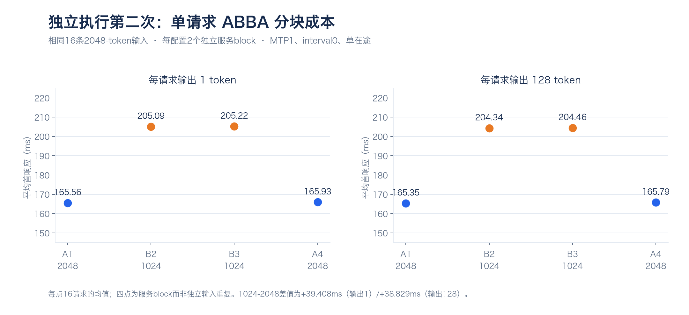
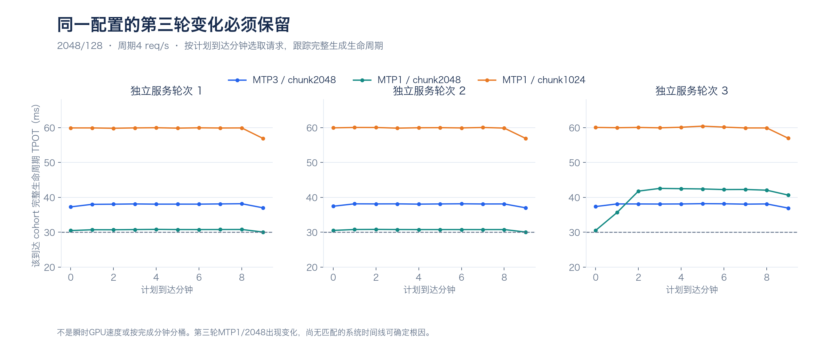
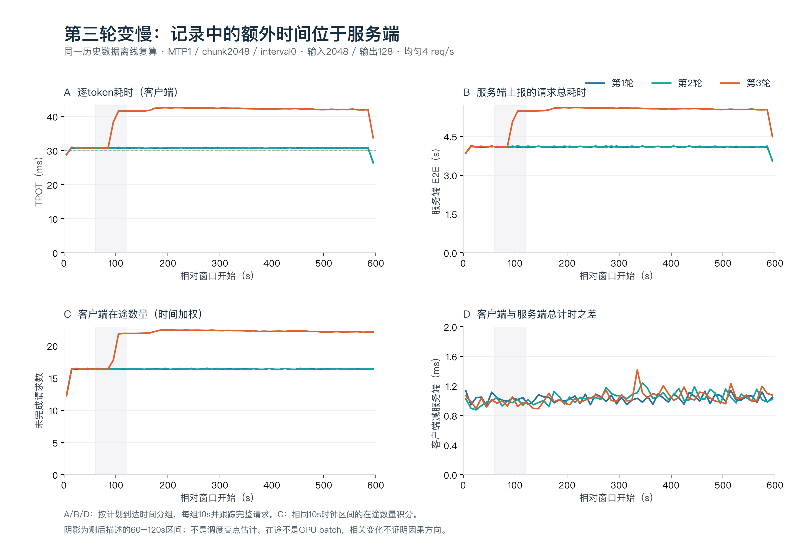
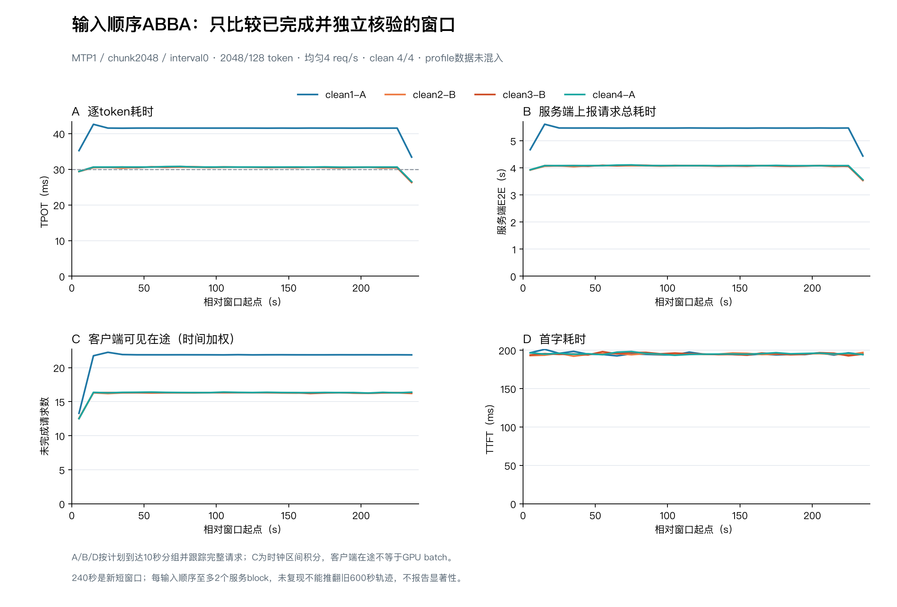

# 2026-11-01 工作日报

**状态：已收口。**

**工作统计范围（北京时间）：2026-10-31 17:00 至 2026-11-01 15:01:27。** 起点由用户明确为昨日17:00；用户在本次消息中宣布截止，本次将收口时刻登记为15:01:27。此前暂定的16:30已被此次明确截止替代。

**统计边界：**此后今天下午、晚间及午夜前的新增工作统一记入[2026-11-02日报](2026-11-02.md)，不再追加到今天的完成事项。11月2日日报从本次截止延续，下一截止若未另行说明，默认11月2日17:00。本文本次定稿属于收口整理，未启动新实验或重新访问远端。

工作主线：完成分块成本的夜间独立复验，核对第三轮性能变化，再用单配置输入顺序ABBA短时诊断检验可复现性；同步完善长期报告、学习材料与公开展示。

## 汇报要点

- **实验已经完成，根因仍未确定。**夜间第二次独立执行完成40个正式case、75,236次计划请求；后续短时诊断4个窗口、3,840次计划请求全部成功，原固定3步服务恢复验收通过。两阶段协议不同，分别统计。
- **小分块有明确成本。**固定MTP1、interval0、单请求条件下，1024相对2048分块额外增加约39ms客户端首响应；长输入高负载下，1024三轮均有更高TPOT和更多拒绝。
- **输入顺序身份不足以单独决定快慢。**短诊断中，同一A顺序独立重启后的平均TPOT为40.9928和30.4140ms；未满足预设“先低后高”取证门槛，未启动profile，也没有放宽门槛追加窗口。
- **材料与展示已完善。**长期报告补全方法、参数、完整测点和10张统计图，已发布提交`9cb6d4b`；破图问题定位到本机访问图片域名的链路，文件及引用路径检查通过，尚未宣称网络问题已修复。

## 本周期完成事项

| 完成时间 / 工作 | 目的与实际完成 | 结果及证据 |
|---|---|---|
| 昨晚至06:02：夜间分块成本隔离与复验 | ABBA微测128请求；三配置、四负载、三轮600秒，共36负载窗、75,108计划请求。 | 全部40正式case完成；73,291成功、1,945本地拒绝、未预期错误0。[晨间报告](../REPORT-NIGHT-ISOLATION-2026-11-01.md) |
| 12:44：第三轮变化离线审计 | 复核既有36负载窗，重点7,200请求；检查计时、验证计数、输入身份与客户端在途。 | 291份证据hash一致；新增GPU请求0。额外约1.227秒体现在服务端上报，仍缺执行阶段归因。[离线报告](../REPORT-DRIFT-AUDIT-2026-11-01.md) |
| 14:18–14:46：输入顺序ABBA短时诊断 | 唯一MTP1/chunk2048/interval0配置，2048/128、周期4req/s；4×240秒、每block独立重启，新增1Hz四卡监测。 | 3,840/3,840成功，零拒绝/错误；同A一慢一快，profile0。14:42独立恢复验收通过。[诊断报告](../REPORT-DRIFT-DIAGNOSTIC-2026-11-01.md) |
| 长期报告建立、细化与绘图 | 按参考报告粒度补充环境、启动参数、指标分母、实验设计、模块活动、完整测点、失败恢复与复现入口。 | 主体补充37张编号表和10张新统计图，后续审计/诊断结果已更新；绘图复用既有数据。[长期报告](../REPORT-PROGRESS.md) |
| 学习材料整理 | 结合项目解释模型服务、KV cache、TP/MTP、并发/到达/batch、调度和实测边界。 | 已在工作目录保存18章学习文稿，帮助阅读报告与代码；不计作性能实验。 |
| GitHub发布与入口确认 | 发布累计报告、当期日报、图表数据与绘图脚本，明确长期报告为`REPORT-PROGRESS.md`。 | 提交`9cb6d4b`已推送；`REPORT.md`继续保留为历史部署基准。[公开记录说明](../results/daily-close-2026-11-01/closure-snapshot.json) |
| 图片显示问题排查 | 核对10张PNG、Markdown路径、GitHub页面、内容API及图片重定向。 | 文件与路径有效；raw图片请求在本机被拒绝。未修改系统网络规则，未宣称已恢复显示。 |
| 日报周期规则更新与本日收口 | 以用户每日指定截止优先，未说明默认17:00；本日范围明确为昨日17:00至本次登记时刻。 | 今日已收口，后续归入11月2日；长期报告与[维护规则](README.md#工作时间范围)同步更新。 |

## 吞吐量评价口径（已有数据补充）

本次补充只复算上述已收口范围内的原始记录，日报仍截止于2026-11-01 15:01:27。所有吞吐均为**四卡服务合计的输出tok/s**；输入token不计入分子。

| 指标 | 计算方式 | 用途 |
|---|---|---|
| 总输出吞吐 T_out（tok/s） | 成功且长度校验通过的正式请求，其实际输出token总数 ÷ 保存的完整测量秒数。 | 看系统实际交付的输出总量。 |
| 达标输出吞吐 G_out（tok/s） | 成功且同时满足TTFT≤500ms、TPOT≤30ms的请求，其实际输出token总数 ÷ 同一完整测量秒数。 | 看满足研究延迟门槛的有效输出；门槛尚非业务确认SLO。 |
| TPOT（ms/token） | 每请求扣除首token等待后的逐token耗时，再按原阶段方法汇总。 | 与总吞吐一起判断单请求生成体验；其倒数不是系统总吞吐。 |

完整测量时间采用各窗口保存的`duration_s`，包含输入处理、到达间隔及末尾排空，排除预热、smoke和服务启动。拒绝没有输出，贡献0token；没有把计划到达率乘128直接当实测吞吐。三轮结果先分别求比值，再等权平均。

原无竞争微测在同一服务block内混合输出1和128，不能把某个子组token数除以共享block时长，称为该子组独立单流吞吐；因此保留其首响应/TPOT指标。纯单流及固定并发吞吐仍见长期报告的既有主基准，不能与固定到达率容量混为一谈。

## 主要结果

各项按六个固定字段记录，时间均为北京时间。历史参照、失败尝试、新增GPU测量和离线复核分别标注；同一数据的图表与吞吐复算不再算新增实验。“下一步”解释当时如何推进，不用截止后的结果补写本日报结论。

### 既有单流/多流基线参照（背景，非本周期新增）

**1. 实验日期和时间**

原测量为2026-10-30主基准阶段，19:43:12完成整阶段验收；本日报中的表是历史测点复用。tok/s口径补充仅复算已有记录，没有新的实验起止，不计入11月1日新增测量。

**2. 为什么做**

汇报当天诊断时，需要交代原保留配置的单流和多流水平，同时避免将固定并发基准与固定到达率实验误当同一容量测量。

**3. 做了什么**

提取固定512/128、TP4、关闭前缀缓存、普通解码与MTP3的C1/C8/C32三轮基准，以实际输出token除原生完整计时。保留日期、负载和配置边界。

**4. 结果怎样**

固定512输入/128输出、四卡TP=4、关闭前缀缓存、固定并发上限的三轮主基准，便于组会上回答当前保留配置的单流/多流水平。MTP列为固定3步、interval0、chunk2048，均采用实际输出/原生完整计时：

| 并发上限C | 普通解码 T_out tok/s | 固定3步MTP T_out tok/s | 三轮配对MTP/普通 |
|---|---|---|---|
| 1 | 101.85 | 187.70 | 1.843× |
| 8 | 605.00 | 675.55 | 1.117× |
| 32 | 1325.57 | 1246.28 | 0.940× |

这是2026-10-30已完成主基准的背景参照，不计入今天新增测量，亦不与下方周期4req/s、MTP1固定到达率实验直接比较容量。原始条件、其它长度与延迟见[长期报告](../REPORT-PROGRESS.md#5-mtp主基准补测与候选验证)。

**5. 得出什么结论**

原保留MTP3配置在该固定输入下单流约187.70 tok/s，C8和C32四卡合计为675.55/1246.28 tok/s。C32相对普通解码0.940×，不能把低并发收益外推高并发；这些数不与今日约511 tok/s的周期4req/s输出率直接比较最大能力。

**6. 成果与下一步**

保留基线表和[长期报告](../REPORT-PROGRESS.md)入口。后续每次性能比较同时记录T_out、G_out、TTFT、TPOT和拒绝；旧基线不重复计为新的实验成果。

### 夜间首次执行：保留失败并独立修订客户端条件

**1. 实验日期和时间**

首次协议创建于2026-10-31 20:39，执行于22:57:34失败并恢复；23:06:52独立恢复验收通过。第二次协议23:21创建、23:25:29启动；两次分别归档。

**2. 为什么做**

分块原型退化后，需要同时测无竞争成本和较长负载，判断额外成本是否只在多请求交错时出现；完整计划为40个case。

**3. 做了什么**

第一次先运行单请求分块微测，再按三配置、四种负载、三轮测量。在MTP1/chunk1024的首轮长输入随机到达窗口发生一次连接断开，按失败规则停止、回收并恢复原服务。

**4. 结果怎样**

15个正式case、22,818次已审计请求保留；失败窗口另外保留2,081成功、263本地拒绝、1连接中断。没有完成完整矩阵，未将这些数并入第二次正式均值。

**5. 得出什么结论**

这是工程失败和恢复证据，不足以给出完整性能结论。历史缺连接trace，连接复用只是有支持的假设，不能声称精确socket根因已确定。

**6. 成果与下一步**

保留首次failed记录及恢复验收。第二次采用每条入服务请求新建连接、无复用、不重试POST，并逐请求检查连接行为；第二次完整结果见以下两项，[阶段报告](../REPORT-NIGHT-ISOLATION-2026-11-01.md)分别记录。

### 1. 夜间分块微测：单请求仍有额外首响应成本

**1. 实验日期和时间**

第二次执行于2026-10-31 23:25:29启动，阶段A配对分析于23:52:55形成；所属整轮在11月1日05:48结束，06:02:47定稿。以上分别是启动、A分析与整轮定稿，不将其写为相同事件。

**2. 为什么做**

先前1024分块在持续负载下更慢，尚不能判断来自分块本身还是多请求竞争。因此先拿掉并发竞争，让相同输入在单在途条件下比较总首响应成本。

**3. 做了什么**

第二次独立执行固定MTP1、interval0、同一16条2048-token输入，ABBA四个独立服务block，每配置两个block；每条实际入服务请求新建连接、零复用、不重试POST。

**4. 结果怎样**

| 输出token | 正式请求 | 首正token差（1024减2048） | TPOT均值差 |
|---|---:|---:|---:|
| 1 | 64 | +39.408ms | 不定义 |
| 128 | 64 | +38.829ms | -0.0015ms |

**5. 得出什么结论**

客户端计时包含连接、CPU和服务路径，不直接当作纯GPU开销；16种输入不是16次独立服务重复。相同输入/输出长度组合的文本hash一致，只是局部输出验证。此前第一次执行在途快照的39.72/39.22ms仍作为历史保存，不与第二次结果合并。

无竞争时仍存在额外约39ms首响应，说明不能把退化全部解释为其他请求插入造成；但CPU、传输、调度和GPU各自贡献尚未拆开。微测同一block混合输出1和128，不能用共享总时长伪造某个输出子组的独立吞吐。

**6. 成果与下一步**

形成四个ABBA服务block、128正式请求的[微测与完整复验报告](../REPORT-NIGHT-ISOLATION-2026-11-01.md)，以及按相同输入和配置内两block平均的差值。随后在600秒负载下检验成本是否被并发收益抵消，并保留所有轮次。

### 2. 夜间600秒负载：小分块退化、第三轮变化均保留

**1. 实验日期和时间**

2026-10-31深夜至11月1日凌晨执行，整轮于11月1日05:48:26结束并恢复，05:51:15独立验收，05:53:32闭环检查，06:02:47报告定稿。B各窗口600秒，启动和结束见对应原始执行记录，不用定稿时刻代替每窗时段。

**2. 为什么做**

单请求额外成本不等于持续服务的最终收益，需要以较长窗口和重复对照检查小分块是否减少生成阻塞，并主动检验不同长度和到达方式下的反例。

**3. 做了什么**

三配置均原生interval0，四种冻结负载×三轮×600秒，共36负载窗。配置按拉丁轮转，同轮同负载输入及到达相同；轮间更换输入顺序与随机seed。以下为2048/128、周期4req/s的完整三轮比较：

第二次协议下每条实际入服务请求新连接、不重试，成功输出长度和零retraction核验；阶段A与B合计40case、75,236计划请求，成功73,291、拒绝1,945、未预期错误0，smoke与预热单列。

**4. 结果怎样**

| 配置 | 第1轮TPOT ms | 第2轮 | 第3轮 | 三轮本地拒绝 |
|---|---:|---:|---:|---|
| MTP3 / chunk2048 | 37.8658 | 37.9179 | 37.8997 | 0 / 0 / 0 |
| MTP1 / chunk2048 | 30.6385 | 30.6515 | 40.2443 | 0 / 0 / 0 |
| MTP1 / chunk1024 | 59.5867 | 59.6393 | 59.7360 | 203 / 202 / 201 |

**同一批2048/128、周期4req/s窗口的输出吞吐：**

| 配置 | 第1轮 T_out tok/s | 第2轮 | 第3轮 | 三轮均值 | 三轮 G_out tok/s |
|---|---|---|---|---|---|
| MTP3 / chunk2048 | 510.92 | 510.93 | 510.95 | 510.93 | 4.19 |
| MTP1 / chunk2048 | 511.09 | 511.08 | 510.90 | 511.02 | 6.74 |
| MTP1 / chunk1024 | 467.54 | 467.76 | 467.92 | 467.74 | 2.13 |

MTP1/chunk2048的第三轮TPOT由约30.65升至40.24ms，但总吞吐仍由约511.08变为510.90tok/s：到达率固定且请求均成功，输出总量近似固定，变慢更多表现为延迟和在途增加。MTP1/chunk1024有拒绝，平均总吞吐降至467.74tok/s。总吞吐接近并不表示请求同样快，也不等于已测最大容量。

**5. 得出什么结论**

小分块的高耗时和拒绝在三轮重复出现；MTP1/2048第三轮由约30.65升至40.24ms，不能概括为稳定优于原3步。三配置三轮中心60%到达队列双门槛达标率均0%；全窗口少量达标不代表持续运行已满足目标。

固定到达率下总吞吐近似受所施加输出流量限制，T_out接近不能否认请求级TPOT变慢。MTP1/2048第三轮变化值得单独审计，不能用三轮均值把状态变化抹平。

**6. 成果与下一步**

形成36负载窗口三轮完整表、T_out/G_out复核、分钟cohort和恢复证据；所有正式请求已回收。下一项先使用这批既有数据做离线审计，核对客户端、服务端计时和验证数量，不立即继续扫块大小。[吞吐复核数据](../results/throughput-review-2026-11-01/throughput-summary.json)保留分子和分母。

### 3. 离线核验：额外时间体现在服务端报告，计数没有变化

**1. 实验日期和时间**

2026-11-01开展本地分析，**12:44:05为离线证据截止和汇总生成时刻**。没有新GPU窗口；旧夜间请求仍对应原先采集时段。

**2. 为什么做**

同一名义配置第三轮变慢，先检查现有记录能否削弱计时差异、输出变长或验证数量增加的解释，再决定需要什么在线取证，避免重复压测却没有缩小问题。

**3. 做了什么**

离线审计12:44:05定稿，复核既有75,108负载计划请求，重点三轮MTP1/chunk2048/interval0的7,200请求。它是既有请求的子集，不增加新测量数。

按请求核对输出token、缓存、回退、验证与草稿计数；将客户端时间戳重建为在途区间，再对88种共同输入身份对齐。

**4. 结果怎样**

| 观察量 | 第1轮 | 第2轮 | 第3轮 |
|---|---:|---:|---:|
| 服务端上报平均E2E s | 4.085949 | 4.087474 | 5.314048 |
| 客户端减服务端计时 ms | 1.0291 | 1.0379 | 1.0360 |
| 每请求验证 / 正确草稿 / 提出草稿 | 64 / 64 / 64 | 64 / 64 / 64 | 64 / 64 / 64 |
| 中心120–480s时间加权客户端在途 | 16.4044 | 16.4006 | 22.2949 |

第三轮服务端上报E2E相对前两轮均值增加1227.337ms，与客户端增量接近；输出128、缓存0、回退0和验证计数均一致。88种共同输入按身份对齐，第三轮全部更慢、成功输出hash相同。这削弱客户端额外开销、记录中的验证次数增多或少数不同输入拉高均值等解释；不能排除输入顺序、动态上下文或服务状态。

在途是客户端请求区间的重建代理，不是实际GPU batch；请求变慢本身会留下更多在途，因果方向仍未知。291份来源文件分析前后以及本次收口复核的hash一致。原离线阶段形成的短诊断设计随后已执行，状态见下一节。

**5. 得出什么结论**

额外约1.227秒主要体现在服务端报告；已记录输出与工作数量没有增加，相同输入身份对齐后仍慢。它们削弱部分替代解释，但服务端E2E不是纯GPU计算，客户端在途不是实际batch，输入顺序和动态上下文仍未排除，不能认定根因。

**6. 成果与下一步**

形成[离线审计报告](../REPORT-DRIFT-AUDIT-2026-11-01.md)、两张图、10秒cohort、来源摘要与最小诊断设计；291份来源hash一致。随后复用旧第一/第三轮输入顺序做ABBA短对照，检验顺序身份是否足以决定快慢；该后续执行见下一项。

### 4. 短时ABBA诊断：同一输入顺序可以一慢一快

**1. 实验日期和时间**

2026-11-01 **14:18:42启动，14:41:22结束并恢复原服务，14:42:45独立验收，14:44:45闭环检查，14:46:43报告定稿**。四个正式窗口各240秒，不把14:46定稿写成采样时刻。

**2. 为什么做**

旧第一轮快、第三轮慢，且输入顺序不同。需要让两种历史顺序在独立启动下重复，检验顺序身份是否能独立解释状态；同时预先限定何时才采内部时间线。

**3. 做了什么**

4个240秒clean窗口，各960计划请求，全部成功、无拒绝/未预期错误；8次冒烟与40次预热单列。固定MTP1/chunk2048/interval0、2048/128、周期4req/s，每block独立重启。A/B精确复用旧第1/3轮前960条输入顺序，另有1Hz四卡监测；不与旧600秒均值合并。

按A/B/B/A独立启动，每种顺序两个服务block；只有完整有效clean窗口满足测前先低后高门槛，才可追加至多一个profile窗口。

**4. 结果怎样**

| 窗口 | 输入顺序 | 平均TTFT ms | 平均TPOT ms | 服务端E2E s | 中心客户端在途 |
|---|---|---:|---:|---:|---:|
| clean1-A | A | 195.229 | 40.9928 | 5.4003 | 21.8871 |
| clean2-B | B | 194.863 | 30.3203 | 4.0446 | 16.3114 |
| clean3-B | B | 195.224 | 30.3529 | 4.0490 | 16.3256 |
| clean4-A | A | 195.437 | 30.4140 | 4.0570 | 16.3508 |

**同一批短时窗口的吞吐补充：**

| 窗口 | 实际成功输出token | 完整计时s | T_out tok/s | G_out tok/s |
|---|---|---|---|---|
| clean1-A | 122,880 | 241.259994 | 509.33 | 11.14 |
| clean2-B | 122,880 | 241.078941 | 509.71 | 14.87 |
| clean3-B | 122,880 | 241.078078 | 509.71 | 15.93 |
| clean4-A | 122,880 | 241.076308 | 509.71 | 15.40 |

例如clean1-A为122,880实际输出token ÷ 241.259994s = 509.33tok/s；后续三窗约509.71tok/s，虽然TPOT分别呈现约41ms与30ms两种状态，总吞吐差异很小。全部请求成功不等于全部满足500ms/30ms门槛，所以G_out远低于T_out；“快状态”是相对描述，不能写成已全部达标。

**5. 得出什么结论**

同A在独立重启后可出现40.9928与30.4140ms，说明输入顺序身份不足以单独决定快慢。每种顺序仅两个独立服务block，不能据此报告显著性或确定根因。

四窗都未满足“连续三个10秒组TPOT<33ms，紧接三个组>35ms”的测前取证门槛，因此**profile窗口0、profile计划请求0**；没有为取得trace放宽门槛或追加窗口。观察到慢状态不等于复现旧窗口的先低后高转变，未触发也不等于没有性能变化。

新增1Hz监测不是GPU执行trace，也不足以根据温度/频率范围确定降频原因；240秒短窗口不替代旧600秒轨迹。

**6. 成果与下一步**

形成[ABBA短时诊断报告](../REPORT-DRIFT-DIAGNOSTIC-2026-11-01.md)、四窗完整记录、T_out/G_out、文本hash对照和恢复验收。72份文件回收匹配；原固定3步/间隔0/chunk2048恢复。按本日报截止，根因仍未确定，下一项设计覆盖快慢状态的实际batch与输入/验证交错取证，截止后结果归11月2日日报。

## 失败、质量与恢复

| 阶段 | 完成与恢复 | 必须保留的边界 |
|---|---|---|
| 夜间首次执行 | 状态failed，15case、22,818已审计请求；失败窗口另外保留2081成功、263拒绝、1连接断开。 | 缺历史连接trace，连接复用只是支持的假设；不混入第二次正式均值。 |
| 夜间第二次执行 | 40case收口；05:48恢复原服务、05:51独立验收，05:53闭环检查；287文件、95,146,527字节回收核验。 | 无未完成窗口或未回收正式请求；远端两次最终各148项通过，本地148项含2项明确跳过。 |
| 14时短诊断 | 14:41:22恢复原MTP3/interval0/chunk2048，14:42:45独立验收；执行器退出、锁释放；72文件、7,610,801字节与远端大小/hash一致。 | 服务器预检及两次最终各163项通过；本地161通过、2项远端连接测试跳过。恢复记录是该时刻验收，不证明当前实时状态。 |

夜间同输入文本hash检查，以及短诊断共同成功输入的输出一致性，是局部验证，不替代广泛语义质量或tokenID等价。服务端E2E不是GPU compute，客户端在途不是调度batch；当前没有直接匹配的执行阶段时间线可以指定通信、温度、初始化或调度中的某一项为根因。

## 吞吐补充的来源与范围

夜间36个负载窗口和短时ABBA4个窗口均从原始请求的实际输出长度、保存的完整计时及研究门槛独立复算；原始文件hash与原汇总一致。离线审计复用了其中既有请求，不新增另一套吞吐测量；第一次失败、预热、smoke及截止后的含profile取证窗口均未并入本表。

[吞吐复核汇总](../results/throughput-review-2026-11-01/throughput-summary.json)保存每窗分子、分母、总/达标输出吞吐、三轮聚合及来源摘要；[指标说明](../results/throughput-review-2026-11-01/README.md)区分固定到达率与固定并发口径。此处是用户要求的范围内指标补充，未更改日报时间边界或原实验结论。

## 文档、发布与显示排障

长期报告现已包含环境/参数、协议、完整测点、模块活动、失败/恢复与复现细节，保留10张新增统计图；本周期的离线审计另有两图，短诊断另有一图。它们是同一证据的不同展示，不累计为新增请求。

公开提交`9cb6d4b`已上传本周期的详细长期报告、日报、10图、派生数据和绘图脚本。其后补入的离线审计、短诊断以及本次收口属于后续文档版本，需要相应同步，不能把已上传旧版本当作当前全部材料已公开。

破图排查已确认：10张PNG存在、引用路径正确、文件可解码；GitHub正文和内容API可达，实际图片请求重定向至`raw.githubusercontent.com`后在本机被拒绝。域名解析/代理分流是待进一步核对的层面，尚未确定具体规则，也未修改系统设置或宣称已修复。该问题不影响本周期实验数值和本地图表。

## 尚未解决的问题

1. 快慢状态下实际scheduler batch、输入处理与验证如何交错，仍缺同一时间段的直接取证。
2. 单请求额外约39ms的客户端首响应，需要分开传输、CPU、调度和GPU成本；不能全记为GPU固定开销。
3. 500ms/30ms仍是研究门槛；三轮或两block不能证明生产容量、统计显著性或跨模型泛化。
4. 1Hz温度、频率和功耗只有相关观察，未采驱动限频原因，不能仅凭范围确定是否降频。

## 下个工作周期的安排

以下均为截至本次收口尚待执行或确认的事项，后续进展记入[11月2日日报](2026-11-02.md)：围绕快/慢状态设计实际batch和输入/验证交错的有界取证，说明采样覆盖与开销；核对图片域名的网络访问；按选定范围同步后续报告。**本次收口不追加GPU实验、不推广候选。**

## 证据入口

- [长期工作报告](../REPORT-PROGRESS.md)
- [夜间分块成本完整复验](../REPORT-NIGHT-ISOLATION-2026-11-01.md)
- [第三轮变化离线审计](../REPORT-DRIFT-AUDIT-2026-11-01.md)
- [ABBA短时在线诊断](../REPORT-DRIFT-DIAGNOSTIC-2026-11-01.md)
- [吞吐复核数据](../results/throughput-review-2026-11-01/throughput-summary.json)
- [本次收口快照与来源摘要](../results/daily-close-2026-11-01/closure-snapshot.json)
- [长期报告绘图数据与口径](../results/work-report-2026-11-01/README.md)
- [日报范围与共同维护规则](README.md)
